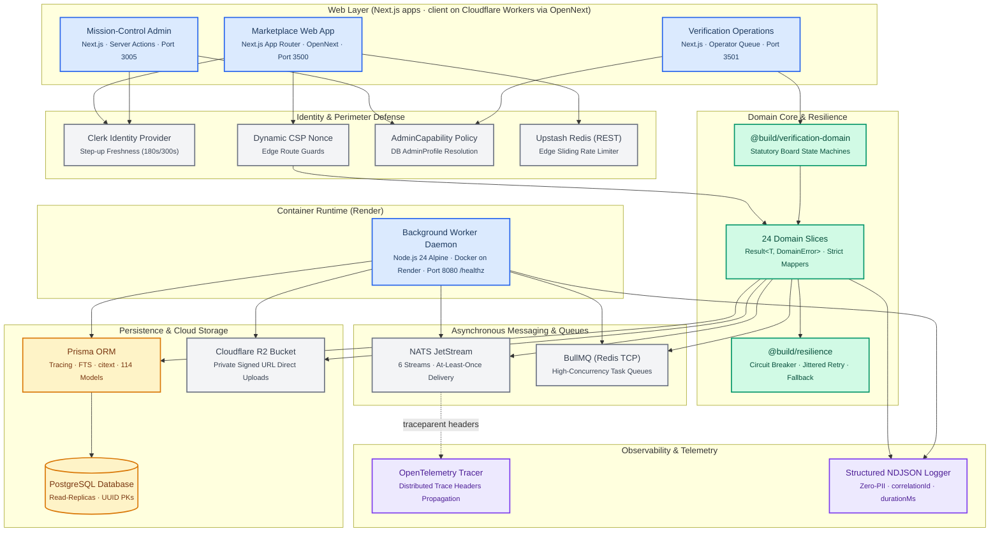
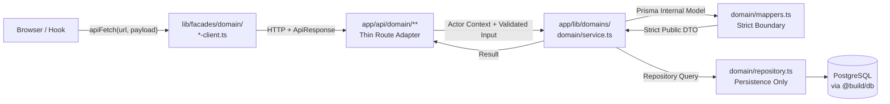
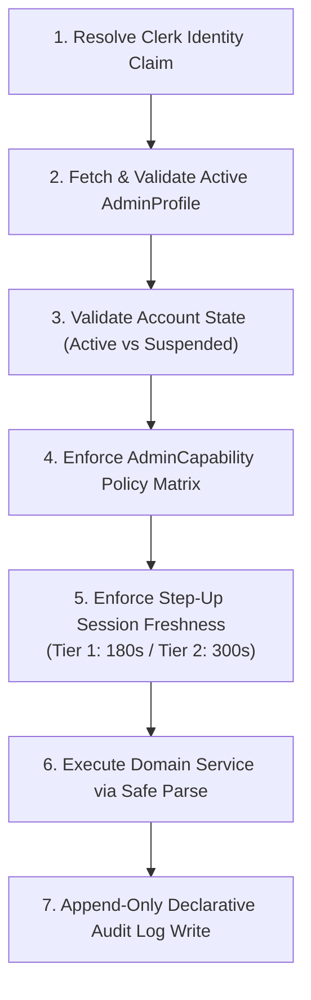
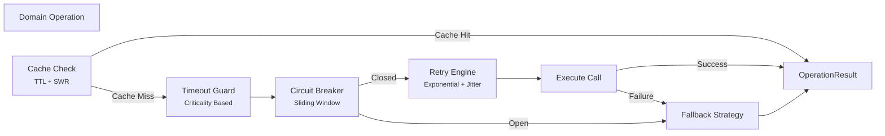
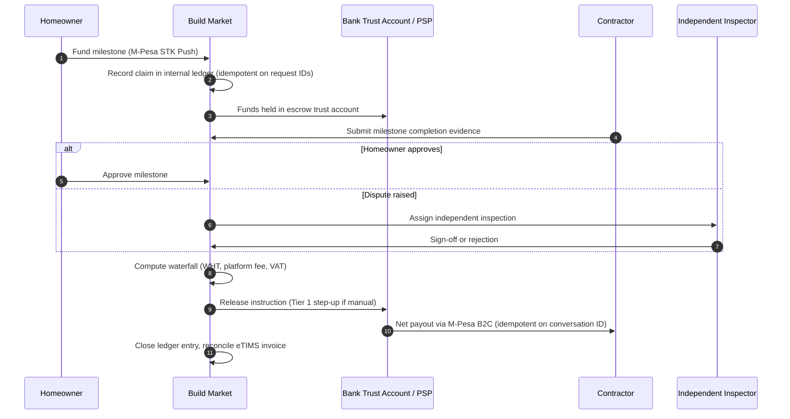
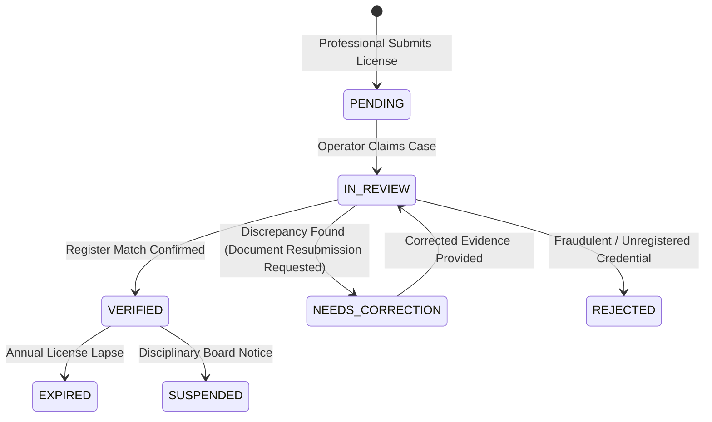
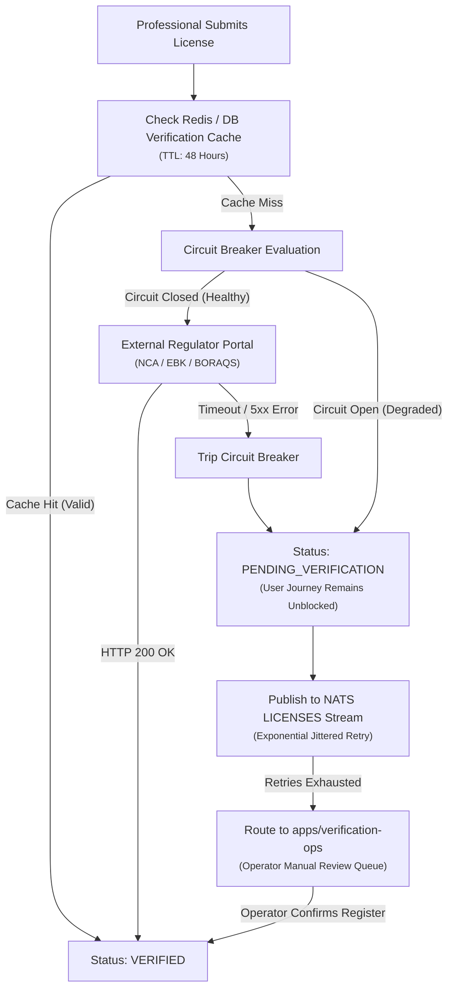

# Build Market — Compliance-First Construction & Real Estate Marketplace for Kenya

_Architecture case study · event-driven backend, non-custodial milestone escrow, built to survive unreliable infrastructure and strict regulation_

| Field          | Detail                                                                                                                                                         |
| -------------- | -------------------------------------------------------------------------------------------------------------------------------------------------------------- |
| **Role**       | Sole architect and engineer: product design, backend, frontend, infrastructure, and compliance modeling                                                        |
| **Timeline**   | 2025 – present · last updated October 2026                                                                                                                     |
| **Status**     | Live at [buildmarket.app](https://buildmarket.app) <!-- AUTHOR: state the real stage (pilot / beta / launched) and any usage numbers; reviewers always ask --> |
| **Core stack** | TypeScript · Next.js on Cloudflare Workers · Node.js 24 · PostgreSQL + Prisma · NATS JetStream · BullMQ · M-Pesa Daraja                                        |

## The 60-Second Version

**Problem.** Construction in Kenya runs on offline trust: contractors are hard to verify, clients pay large deposits with no protection, and the registers that could confirm a credential live on portals that are frequently down.

**Approach.** Build Market is a technology intermediary, not a contractor. It verifies professionals against nine statutory boards, holds milestone payments in non-custodial bank escrow, and runs on an event-driven backend that treats external failure as the normal case.

**The three hardest problems**

1. **Reliability against unreliable regulators.** Cache, circuit breaker, retry stream, then a human review queue, so the user journey never blocks (Section 8).
2. **Money-movement correctness.** Idempotent M-Pesa flows, deterministic message IDs, and acknowledge-after-commit delivery so a crash can never double-pay (Sections 2.3, 3.1).
3. **Governance without a team.** 26 ADRs enforced by static checks, since there is no second reviewer on a solo project (Sections 4, 6).

**Evidence.** 4 apps · 8 shared packages · 114 models · 6 JetStream streams · 26 ADRs · security drift scanner at 0 findings across 309 files.

## Contents

1. Technical architecture and stack justification
2. Architectural deep-dives
3. Localized Kenyan ecosystem integrations
4. Architectural decision records
5. Observability and operational readiness
6. Testing, drift gates, and verification
7. Admin overhaul and strangler-fig evolution
8. Designing for legacy unreliability
9. Failure modes and threat model
10. Engineering tradeoffs and retrospective
11. Key technical differentiators
12. Outcomes, evidence, and screenshots

- Appendix A: Glossary

---

## Executive Summary

Build Market is an event-driven marketplace, project-coordination engine, and statutory compliance platform engineered to address the trust deficit, operational fragmentation, and rigorous regulatory requirements of the construction and real estate sectors in East Africa — specifically tailored for the Kenyan market.

The platform connects five distinct stakeholder classes — **property owners & developers** (individual homeowners, commercial developers, diaspora investors), **registered professionals** (architects, civil/structural engineers, quantity surveyors, physical planners, and 30+ trade categories), **materials suppliers & hardware stores** (building material distributors, equipment hire firms), **independent dispute inspectors**, and **statutory regulatory authorities** — under a unified, audit-logged ecosystem that introduces transparency, milestone-gated capital protection, and provenance to a historically offline-first industry.

### The Problem, and Where the Design Answers It

| Real-world problem                                          | Consequence                                      | Design response                                                                  | Section      |
| ----------------------------------------------------------- | ------------------------------------------------ | -------------------------------------------------------------------------------- | ------------ |
| Credentials are claimed, not verified                       | Unqualified or fraudulent practitioners win work | Statutory verification state machine across 9 boards, with human review fallback | 3.2, 8       |
| Clients pay large deposits upfront                          | No recourse if work stalls or is substandard     | Milestone-gated, non-custodial bank escrow with transparent payout waterfall     | 3.1          |
| Government registers are slow, down, or change schema       | Onboarding blocks or fails                       | Cache, circuit breaker, async retry stream, operator queue                       | 8            |
| Platform could be mistaken for the contractor               | Regulatory and liability exposure                | Strict intermediary posture; verification badges are dated factual statements    | Philosophy 1 |
| Heavy handling of national IDs, KRA PINs, and phone numbers | Privacy and breach exposure                      | Class A–D data classification, zero-PII logging, 72-hour breach workflow         | 2.5, 5       |
| One engineer must keep a large system coherent              | Boundary erosion and drift                       | ADRs backed by AST checks and a drift scanner in CI                              | 4, 6         |

### System At Scale

| Dimension                    | Scope & Metrics                                                                                                                                                                                                                      |
| ---------------------------- | ------------------------------------------------------------------------------------------------------------------------------------------------------------------------------------------------------------------------------------ |
| **Workspace Topology**       | Turborepo monorepo with 4 isolated applications (`apps/client`, `apps/admin`, `apps/verification-ops`, `apps/workers`) and 8 shared packages (`db`, `verification-domain`, `nats`, `resilience`, `redis`, `types`, `ui`, `enums`)    |
| **Data Model**               | 4,617-line Prisma schema with 114 relational models, 120 strict enums, PostgreSQL with `pgcrypto`, `citext`, full-text search, and query-level OpenTelemetry tracing                                                                 |
| **Domain Slices**            | 24 independent vertical domain slices (`properties`, `projects`, `verifications`, `messaging`, `pipeline`, `stores`, `licenses`, `gdpr`, `escrow`, …) enforcing unidirectional dependency flow                                       |
| **Event Streams**            | 6 persistent NATS JetStream streams (`VERIFICATION`, `USERS`, `ORDERS`, `PROJECTS`, `NOTIFICATIONS`, `LICENSES`) with at-least-once explicit acknowledgment and deterministic deduplication                                          |
| **Architectural Governance** | 26 ratified Architecture Decision Records (10 in `apps/client` [ADR-001–010], 16 in `apps/admin` [ADR-ADMIN-001–016]) governing layer boundaries, session freshness, and worker isolation                                            |
| **Quality Gates**            | CI-enforced security drift scanner (0 findings across 309 files), environment-contract checks (75 keys), feature-flag governance, and AST boundary tests                                                                             |
| **Statutory Authorities**    | 9 Kenyan regulatory boards validated at the schema and domain level (`NCA`, `EBK`, `BORAQS`, `EARB`, `EPRA`, `VRB`, `ISK`, `NEMA`, `KEBS`)                                                                                           |
| **Geographic Coverage**      | All 47 Kenyan counties modeled as strict database enums with county-indexed spatial and professional querying                                                                                                                        |
| **Financial & Tax Rails**    | Safaricom M-Pesa Daraja 2.0 (STK Push C2B, PayBill, B2C automated disbursements, B2B settlements), KRA eTIMS invoice reconciliation, Digital Marketplace Withholding Tax (WHT) waterfalls, and non-custodial bank escrow trust deeds |
| **Deployment Topology**      | Hybrid cloud architecture: Cloudflare Workers edge compute (OpenNext BFF), Render-hosted containerized background daemons (Node.js 24 on Alpine), Upstash Redis (REST rate limiting), and managed PostgreSQL                         |

### Core Engineering Philosophy

Build Market is not a CRUD application with marketplace features bolted on. It is a **compliance-first, resilient distributed platform** where every architectural decision is evaluated against four strict forcing functions:

1. **Statutory Intermediary Reality** — Under Kenyan law (_Engineers Act 2011_, _Cap 525 BORAQS Act_, _NCA Act 2011_), the platform must operate strictly as a technology marketplace intermediary. It never warrants building works directly; construction contracts remain strictly bilateral (Homeowner–Contractor), inspection panels are independent, and verification badges are legally factual statements of register confirmation on specific dates.
2. **Legacy Infrastructure Degradation** — Government statutory portals (NCA, EBK, BORAQS, KRA) experience frequent downtime, rate-limiting, and unannounced schema drift. The architecture treats external dependency failure as normal operating condition, chaining edge caches, sliding-window circuit breakers, and asynchronous NATS retry streams.
3. **Financial Correctness & Anti-Commingling** — In anticipation of the _National Payment System Bill (2026)_ and _POCAMLA (2023 AML/CFT Amendment)_, the platform enforces non-custodial escrow via licensed commercial bank trust accounts. Client funds never commingle with operational capital, all payouts execute via idempotent state machines, and disbursements account for eTIMS validation and statutory withholding tax. <!-- VERIFY: confirm the exact titles, status, and citations of the National Payment System Bill (2026) and the POCAMLA 2023 amendment before publishing; cite them in a footnote. -->
4. **Data Sovereignty & Provable Erasure** — Kenya’s Data Protection Act (2019) and ODPC 2021 Regulations mandate strict field-level data classification (Class A–D), 72-hour breach notification playbooks, versioned consent records, and cryptographically verified, tamper-evident GDPR/DPA export and anonymization pipelines.

> [!NOTE]
> This case study describes engineering design decisions. Statutory references reflect the regulatory landscape at the time of writing and are not legal or tax advice.

---

## 1. Technical Architecture & Stack Justification

### 1.1 System Topography



<!-- AUTHOR: reviewers will ask how Workers-hosted code reaches PostgreSQL, NATS, and BullMQ (all TCP-based). Name the mechanism (e.g. Hyperdrive or a Prisma driver adapter, NATS over WebSocket, or an enqueue endpoint on the worker daemon) and add one sentence here. Also confirm the "Read-Replicas" label on the PostgreSQL node matches production. -->

### 1.2 Monorepo Structure

Build Market is structured as a **Turborepo monorepo** using **pnpm workspaces** to enforce absolute isolation between presentation adapters, core domain logic, background workers, and persistent schemas:

```
build-market/
├── apps/
│   ├── client/                  # Marketplace Portal (Next.js App Router, Port 3500)
│   │   ├── app/
│   │   │   ├── api/             # Thin HTTP route adapters (auth, rate limits, safeParse)
│   │   │   ├── actions/         # Server action adapters (BFF pattern)
│   │   │   └── lib/
│   │   │       ├── domains/     # 24 client-side vertical domain slices
│   │   │       ├── security/    # Role normalization, CSP nonce, route guards
│   │   │       └── validation/  # Zod schema boundaries
│   │   └── lib/facades/         # Browser-safe HTTP client facades
│   ├── admin/                   # Enterprise Mission-Control (Next.js, Port 3005)
│   │   └── src/
│   │       ├── actions/admin/   # safeAction-wrapped mutations with declarative audit
│   │       ├── lib/domains/     # Admin domain services (users, finance, audit, GDPR)
│   │       └── lib/security/    # AdminCapability policy maps & freshness guards
│   ├── verification-ops/        # Statutory Regulator Queue Console (Next.js, Port 3501)
│   │   └── src/
│   │       ├── app/(dashboard)/ # Specialized operator verification workflows
│   │       └── lib/actions/     # Multi-approver statutory decision actions
│   └── workers/                 # Background Daemon (Node.js 24 Docker Daemon, Port 8080)
│       └── src/
│           ├── consumers/       # NATS JetStream event subscribers
│           ├── queues/          # BullMQ queue workers (Sharp blurhash, PDF BoQ, cleanup)
│           └── healthz.ts       # HTTP liveness & readiness probe
├── packages/
│   ├── db/                      # 4,617-line Prisma schema, extensions, migration history
│   ├── verification-domain/     # Shared statutory board contracts, reason codes & DTOs
│   ├── nats/                    # NATS JetStream client, producer, consumer, metrics
│   ├── resilience/              # Circuit breaker, retry with jitter, timeout, cache
│   ├── redis/                   # Dual-transport: Upstash REST + BullMQ TCP connections
│   ├── enums/                   # Centralized authoritative enums (statutory, financial, counties)
│   ├── types/                   # Cross-cutting TypeScript interfaces & Zod DTO contracts
│   └── ui/                      # Shared design system components (Radix primitives)
└── turbo.json                  # Pipeline build definitions with remote caching
```

### 1.3 Stack Justification

| Layer                   | Technology                         | Architectural Rationale                                                                                                                                                                                                                                                                                                            |
| ----------------------- | ---------------------------------- | ---------------------------------------------------------------------------------------------------------------------------------------------------------------------------------------------------------------------------------------------------------------------------------------------------------------------------------- |
| **Frontend & BFF**      | Next.js App Router + OpenNext      | Server Actions establish a strict Backend-For-Frontend (BFF) boundary. Sensitive credentials (M-Pesa Consumer Secrets, Clerk Secret Keys) and private business rules never cross to the browser. Edge middleware handles dynamic CSP nonce injection and path-based authorization.                                                 |
| **Worker Host**         | Node.js 24 Alpine Daemon on Render | CPU-intensive media transformations (Sharp WebP encoding, Blurhash generation), long-running PDF Bill of Quantities (BoQ) compiling, and continuous NATS message consumption run on isolated worker instances with a dedicated `/healthz` probe, shielding Next.js web instances from thread starvation (ADR-010 / ADR-ADMIN-016). |
| **Database**            | Prisma ORM + PostgreSQL            | Strict relational modeling for 114 domain entities. `pgcrypto` handles field-level encrypted secrets; `citext` ensures case-insensitive email/identity searches; composite GiST/GIN indexes enable full-text search across listings and contractor profiles. Prisma preview `tracing` enables query-level distributed telemetry.   |
| **Messaging**           | NATS JetStream                     | Low-latency messaging with durable broker persistence across 6 persistent streams. At-least-once explicit acknowledgments decouple high-throughput user interactions from statutory verification checks, SMS dispatch, and invoice reconciliation.                                                                                 |
| **Background Queues**   | BullMQ over Redis TCP              | Stateful, high-concurrency job scheduling with delayed execution, exponential backoff, and dead-letter handling. Separated from NATS to handle stateful task execution rather than distributed event publishing.                                                                                                                   |
| **Edge Cache & Limits** | Upstash Redis (REST)               | Serverless HTTP-based rate limiting compatible with Cloudflare Workers edge runtime. Actor-scoped rate limits throttle malicious brute-force attempts and protect fragile external regulator endpoints.                                                                                                                            |
| **Identity & Access**   | Clerk + DB `AdminProfile`          | Clerk acts as the runtime identity provider with session freshness tracking. Authorization is capability-based: runtime claims map to an authoritative database `AdminProfile`, preventing stale token privilege escalation.                                                                                                       |
| **Asset Storage**       | Cloudflare R2                      | Direct-to-cloud signed upload tokens bypass web application servers. Files are uploaded directly to private S3-compatible R2 buckets with pre-signed authorization, followed by background asynchronous malware scanning and CDN activation.                                                                                       |

### 1.4 Alternatives Considered

<!-- AUTHOR: rows are drafted from your ADRs. Edit to match your actual reasoning and add any alternatives you evaluated and rejected (Kafka, SQS, custom auth, etc.). -->

| Decision                                                   | Alternative                       | Why this choice                                                                                        | Tradeoff accepted                                          |
| ---------------------------------------------------------- | --------------------------------- | ------------------------------------------------------------------------------------------------------ | ---------------------------------------------------------- |
| NATS JetStream for events **and** BullMQ for jobs          | One system for both               | Events are published and fanned out; jobs are stateful, delayed, and retried. Each tool fits one shape | Two systems to operate and monitor                         |
| Dedicated worker daemon (ADR-010)                          | Cron or long tasks inside Next.js | Image encoding and queue polling must not starve web threads                                           | An extra deployable and a `/healthz` contract              |
| Capability auth resolved from the database (ADR-ADMIN-001) | Roles in Clerk JWT metadata       | JWT claims can be stale or revoked                                                                     | A database read on every admin mutation                    |
| Non-custodial escrow via licensed bank or PSP              | Holding client funds directly     | Avoids commingling and payment-system licensing exposure                                               | Dependence on a bank or PSP partner                        |
| Vertical domain slices in one monorepo (ADR-003)           | Separate services per domain      | One engineer, one deploy, with boundaries still enforced                                               | Discipline is enforced by static checks, not network walls |
| Strangler-fig with feature flags (ADR-ADMIN-009)           | Big-bang admin rewrite            | Incremental production verification and instant rollback                                               | Temporary duplicate routes and flag lifecycle management   |

---

## 2. Architectural Deep-Dives

### 2.1 Thin Route Adapters & Unidirectional Data Flow

Build Market mandates a strict separation between transport mechanics and business rules. HTTP API route handlers and Server Actions are strictly **thin adapters**. They contain zero domain logic, zero raw Prisma queries, and zero direct external service calls.

### Canonical Data Flow



### Responsibility Matrix Across Layers

| Layer                      | Must Own                                                                                                                                                                                                                                              | Must Never Own                                                                             |
| -------------------------- | ----------------------------------------------------------------------------------------------------------------------------------------------------------------------------------------------------------------------------------------------------- | ------------------------------------------------------------------------------------------ |
| **Route / Action Adapter** | Timing capture (`startedAt`), correlation ID extraction, actor rate-limiting, Zod `.safeParse()` (never `.parse()`), `If-Match` optimistic concurrency, idempotency lifecycle, resilient executor invocation, HTTP status mapping, structured logging | Business invariants, role permission logic, direct Prisma calls, internal entity reshaping |
| **Domain Service**         | Actor capability validation, business rule execution, cross-repository transactions, `Result<T, DomainError>` envelope construction, invocation of strict mappers                                                                                     | HTTP request/response semantics, status codes, cookies, raw Prisma queries                 |
| **Mapper (`mappers.ts`)**  | Deterministic type conversion: `Decimal → number`, `Date → ISO 8601 string`, null coalescing, stripping internal/sensitive Class A/B fields                                                                                                           | Database calls, external HTTP calls, side effects                                          |
| **Repository**             | Pure persistence: Prisma reads/writes, soft-delete filtering (`deletedAt: null`), table lock orders, transactional queries                                                                                                                            | Authorization policies, response formatting, user error messaging                          |

### Production Implementation: Property Creation Route

The properties POST handler exhibits the canonical 7-step adapter sequence:

```typescript
// apps/client/app/api/properties/route.ts
export const POST = withAuth(async (req, { dbUserId, userRole }) => {
  // ① Absolute first statement: Start timer & bind correlation context
  const startedAt = now();
  const correlationId = initializeCorrelationId(req);

  // ② Actor-scoped rate limit (protecting against automated scripting)
  const rateLimitResult = await checkRateLimit(
    getActorRateLimitIdentifier(dbUserId, "property-write"),
    RateLimits.WRITE.limit,
    RateLimits.WRITE.window,
  );
  if (!rateLimitResult.success) {
    logger.warn({
      correlationId,
      operationName: "create_property",
      outcome: "rate_limited",
    });
    return apiError("Rate limit exceeded", 429, correlationId);
  }

  // ③ Strict Zod validation (safeParse prevents unhandled runtime exceptions)
  const body = await req.json().catch(() => null);
  const validation = CreatePropertySchema.safeParse(body);
  if (!validation.success) {
    logger.info({
      correlationId,
      operationName: "create_property",
      outcome: "validation_error",
    });
    return apiValidationError(validation.error, correlationId);
  }

  // ④ Idempotency enforcement — Summary key derived from actor and payload
  const idempotencyKey =
    req.headers.get("Idempotency-Key") ||
    IdempotencyService.generateKey(dbUserId, "POST", {
      domain: "property",
      titleHash: hashString(validation.data.title),
    });

  // ⑤ Resilient Domain Execution
  const executionResult = await getResilientExecutor().execute(
    () =>
      propertiesService.createProperty(
        { userId: dbUserId, role: userRole },
        validation.data,
      ),
    { operationName: "create_property" },
  );

  // ⑥ Two-level unwrap: Transport/Infra level followed by Domain Result
  if (!executionResult.success || !executionResult.data) {
    await safeIdempotencyFail(idempotencyKey);
    return apiError("Internal server error", 500, correlationId);
  }

  const domainResult = executionResult.data;
  if (!domainResult.ok) {
    await safeIdempotencyFail(idempotencyKey);
    return apiDomainError(domainResult.error, correlationId);
  }

  // ⑦ Complete idempotency and return standardized API envelope
  await safeIdempotencyComplete(idempotencyKey, domainResult.data);
  return apiSuccess(domainResult.data, 201, correlationId);
});
```

---

### 2.2 Capability-Based Admin Security Model

The administrative control center (`apps/admin`) abandons coarse, vulnerable role-string comparisons (`if (role === "ADMIN")`) in favor of an **exhaustive, capability-based security model** backed by ADR-ADMIN-001 and ADR-ADMIN-008.

### Admin Actor Resolution & Trust Boundary

```typescript
// Verified Admin Actor Shape (ADR-ADMIN-001)
export type AdminActor = {
  clerkId: string; // Verified identity claim from active Clerk session
  dbUserId: string; // Primary key in PostgreSQL database
  adminRole: AdminRole; // Resolved strictly from DB AdminProfile (never Clerk metadata)
  sessionId: string; // Active session identifier for freshness calculation
  sessionAuthTime: Date; // Timestamp of last re-authentication
};
```

> [!IMPORTANT]
> `adminRole` is resolved from the database `AdminProfile` record on every single mutation. Claims inside Clerk JWT tokens can be stale or revoked; the database record represents the sole authoritative root of truth for administrative elevation.

### The `safeAction` Security Pipeline

Every administrative mutation is wrapped in `safeAction`, executing a non-bypassable 7-step pipeline:



### Step-Up Session Freshness Tiers

| Freshness Tier        | Window               | Operations Governed                                                                                        | Failure Behavior                                                                  |
| --------------------- | -------------------- | ---------------------------------------------------------------------------------------------------------- | --------------------------------------------------------------------------------- |
| **Tier 1 — Critical** | `maxAgeSeconds: 180` | Role modifications, user suspension/deletion, manual financial reversals, escrow release, PII data exports | Throws `STEP_UP_AUTH_REQUIRED` modal prompting password/biometric re-verification |
| **Tier 2 — Elevated** | `maxAgeSeconds: 300` | Statutory license overrides, contractor category verification, dispute referee assignment                  | Throws `STEP_UP_AUTH_REQUIRED`                                                    |
| **Standard**          | Session Default      | Read-only analytics, support ticket triage, content moderation                                             | Standard session expiration                                                       |

### Granular Capability Enforcement

```typescript
// ✅ Mandatory: Verified capability-based evaluation
await requireAdminCapability(actor, AdminCapability.OVERRIDE_VERIFICATION);

// ❌ Tracked critical defect: Prohibited raw role-string evaluation
if (actor.adminRole === "SUPER_ADMIN" || actor.adminRole === "ADMIN") { ... }
```

---

### 2.3 Event-Driven Orchestration with NATS JetStream

Cross-service communication and background processes are orchestrated through **NATS JetStream**, completely decoupling synchronous user latency from heavyweight downstream operations.

### Stream Topology & Retention Guarantees

Build Market configures 6 persistent streams with strict, domain-tailored retention and deduplication profiles:

| Stream Name     | Subjects         | Retention Policy | Max Age  | Deduplication Window               | Purpose                                               |
| --------------- | ---------------- | ---------------- | -------- | ---------------------------------- | ----------------------------------------------------- |
| `VERIFICATION`  | `verification.>` | Limits           | 7 days   | No `msgId` (server default window) | Contractor & property credential lifecycle tracking   |
| `USERS`         | `user.>`         | Limits           | 30 days  | No `msgId` (server default window) | Account lifecycle, consent records, profile updates   |
| `ORDERS`        | `order.>`        | Limits           | 90 days  | No `msgId` (server default window) | Materials purchase orders, BoQ checkouts, store items |
| `PROJECTS`      | `project.>`      | Limits           | 90 days  | No `msgId` (server default window) | Construction milestones, site sheets, change orders   |
| `NOTIFICATIONS` | `notification.>` | WorkQueue        | 24 hours | No `msgId` (server default window) | Transactional SMS (Africa's Talking), push, email     |
| `LICENSES`      | `license.>`      | Limits           | 30 days  | **120 seconds**                    | Statutory regulatory board checks & manual overrides  |

### Explicit Acknowledgment Lifecycle

Message consumers adhere to an explicit acknowledgment contract. Handlers never interact with raw broker primitives; the consumer framework guarantees that failures result in either exponential backoff retries or dead-letter termination:

```
Message Arrives at Consumer
      │
      ▼
Decode JSON Payload ────► [Decode Corrupted?] ────► msg.term()  (Poison-pill termination)
      │
      ▼
Restore OpenTelemetry Parent Span Context
      │
      ▼
Invoke Registered Domain Handler
      │
      ├─ Throws Transient Error ──► Delivery Count Exhausted?
      │                                  ├─ Yes ──► Publish to Dead-Letter Subject & msg.term()
      │                                  └─ No  ──► msg.nak(exponentialBackoffDelay)
      │
      └─ Resolves Successfully ───► msg.ack()  (Removed from redelivery queue)
```

**The Invariant:** `msg.ack()` is invoked _only after_ the database transaction commits. In the event of an ungraceful node crash between the database write and acknowledgment, the message is redelivered. Because all domain event handlers are designed with **idempotent upsert semantics**, redelivery produces zero inconsistent state.

### Deterministic Content-Addressed Deduplication

To prevent duplicate processing during network partitions or retry storms, messages published to sensitive streams use deterministic, content-addressed IDs:

```typescript
// Deterministic message ID generation for deduplication
const msgId = `${licenseId}-verify-${verificationAttemptNumber}`;
await producer.publishWithRetry("license.auto_verified", eventPayload, {
  msgId,
  maxRetries: 3,
});
```

Within the `LICENSES` stream’s 120-second deduplication window, any duplicate message with the same `msgId` is silently dropped by the NATS server, eliminating duplicate verifications.

---

### 2.4 Production Resilience Pipeline

Domain calls wrap inside the custom `@build/resilience` pipeline. Rather than arbitrary `try/catch` blocks, resilience behaves as a declarative policy engine combining **timeouts, circuit breakers, jittered exponential backoffs, and fallback caches**:



### Criticality Tier Profiles

| Criticality Tier | Target Operations                                 | Timeout  | Retry Strategy                                           | Circuit Breaker Policy        | Cache Strategy                      |
| ---------------- | ------------------------------------------------- | -------- | -------------------------------------------------------- | ----------------------------- | ----------------------------------- |
| **Critical**     | Escrow releases, M-Pesa STK push, user bans       | 3,000ms  | 0 retries (fail fast)                                    | Threshold: 3 failures / 30s   | None                                |
| **Normal**       | Property search, contractor listings, store items | 5,000ms  | 3 attempts, exponential backoff (200ms base) with jitter | Threshold: 5 failures / 60s   | 60s TTL, 30s Stale-While-Revalidate |
| **Background**   | Government portal sync, PDF generation, analytics | 15,000ms | 5 attempts with exponential backoff                      | Threshold: 10 failures / 120s | 300s TTL                            |

---

### 2.5 GDPR & Kenya Data Protection Act Compliance

Data privacy is architected directly into the database schema and storage policies, meeting both the **Kenya Data Protection Act (2019)** / ODPC 2021 Regulations and **GDPR/UK GDPR** (critical for diaspora property investors).

### Data Classification Matrix

| Data Class                        | Concrete Examples                                                                                             | Structured Logs                  | Browser Storage | Audit Trail Persistence                              |
| --------------------------------- | ------------------------------------------------------------------------------------------------------------- | -------------------------------- | --------------- | ---------------------------------------------------- |
| **Class A: Restricted**           | M-Pesa API secrets, Clerk signing keys, database credentials                                                  | **Prohibited**                   | **Prohibited**  | Never stored                                         |
| **Class B: Sensitive PII**        | National ID (ID/Passport), KRA PINs, phone numbers, email addresses, site GPS coordinates, KYC identity scans | **Strictly Masked / Prohibited** | **Prohibited**  | Explicit opt-in only with automated retention limits |
| **Class C: Internal Operational** | UUID resource IDs, correlation IDs, timestamps, capability flags, state machine enum statuses                 | Allowed                          | Allowed         | Append-only audit records                            |
| **Class D: Public Domain**        | Verified business names, public portfolio photographs, county listing regions, store opening hours            | Allowed                          | Allowed         | Public read-replicas                                 |

### Compliance Data Architecture

```prisma
// Core Compliance Records in packages/db/prisma/schema.prisma
model ConsentRecord {
  id               String       @id @default(uuid())
  userId           String
  consentType      ConsentType  // TERMS_OF_SERVICE, PRIVACY_POLICY, MARKETING_COMMUNICATIONS
  version          String       // E.g., "v2.1"
  ipAddress        String?      // Provenance capture
  userAgent        String?
  grantedAt        DateTime     @default(now())
  withdrawnAt      DateTime?
  user             User         @relation(fields: [userId], references: [id], onDelete: Cascade)

  @@unique([userId, consentType])
  @@index([consentType, grantedAt])
}

model AuditLog {
  id               String       @id @default(uuid())
  actorUserId      String
  actorRole        AdminRole
  action           AuditAction
  targetResource   String
  targetResourceId String
  legalBasis       LegalBasis   // CONSENT, CONTRACT, LEGAL_OBLIGATION, LEGITIMATE_INTEREST
  metadata         Json         // Class C/D metadata diffs only (Zero PII)
  ipAddress        String
  createdAt        DateTime     @default(now())

  @@index([actorUserId, createdAt])
  @@index([targetResource, targetResourceId])
}
```

### 72-Hour Incident Response Workflow

Under Section 43 of Kenya's DPA 2019, data breaches presenting risks to user rights must be reported to the Office of the Data Protection Commissioner (ODPC) within **72 hours of awareness**. The system includes automated incident logging (`SecurityIncident` model) that records:

1. Affected data classification tiers (Class A through D).
2. Number of affected records and user identifiers.
3. Cryptographic hash of impacted data categories.
4. Exportable compliance dossier containing incident timelines, root cause analysis, and remediation actions for formal submission to the ODPC.

---

### 2.6 Direct-to-Cloud Asset Management Pipeline

To prevent Next.js server threads and edge workers from blocking on massive multi-megabyte payloads (architectural blueprints, site inspection videos, store catalogs), Build Market implements a **direct-to-cloud signed upload pipeline** via Cloudflare R2:

```mermaid
sequenceDiagram
    autonumber
    participant Browser as Client Browser
    participant API as Next.js API Adapter
    participant S3 as Cloudflare R2 Bucket
    participant Worker as Background Worker Daemon

    Browser->>API: POST /api/uploads/signed-url (filename, mimeType, size)
    API->>API: Validate file type & size quota; generate signed token
    API-->>Browser: Signed Upload URL + Asset Tracking ID
    Browser->>S3: PUT [Binary Payload] directly to Signed URL
    S3-->>Browser: 200 OK (ETag returned)
    Browser->>API: POST /api/uploads/confirm (Asset ID, ETag)
    API->>Worker: Enqueue "asset.activate" task to BullMQ
    Worker->>S3: Validate upload, run malware check, generate WebP & Blurhash
    Worker->>API: Mark Asset status = ACTIVE
```

Orphaned uploads (signed tokens issued but never confirmed) are automatically pruned after 24 hours by an automated BullMQ cleanup worker.

---

### 2.7 Background Worker Isolation & Queue Semantics

In compliance with **ADR-010** and **ADR-ADMIN-016**, background jobs are decoupled from web applications and consolidated into a dedicated worker daemon (`apps/workers`):

1. **Separation of Concerns:** Next.js web application instances handle fast HTTP request/response lifecycles. They never process long-running tasks, heavy image encoding, or continuous queue polling.
2. **Dual-Transport Redis Architecture:**
   - **Upstash Redis (REST):** Stateless, edge-compatible HTTP calls used for actor rate-limiting in Cloudflare Workers edge middleware.
   - **Redis TCP Connection:** High-throughput, persistent TCP connection used by BullMQ within the containerized Render worker daemon.
3. **Liveness & Readiness Health Probes:** The worker daemon exposes an HTTP endpoint on port 8080 (`/healthz`). Container orchestrators (Render/Docker) continuously query this probe. If NATS subscriptions stall or the Redis TCP connection disconnects, the probe fails and triggers container recreation.

---

## 3. Localized Kenyan Ecosystem Integrations

Build Market embeds the Kenyan financial, legal, and operational landscape directly into the domain logic and schema definitions.

### 3.1 M-Pesa Financial Integration & Non-Custodial Escrow

The platform integrates Safaricom M-Pesa Daraja 2.0 across three transaction modes with strict idempotency:

| Mode             | Purpose                                        | Prisma Model       | Idempotency Anchor                                         |
| ---------------- | ---------------------------------------------- | ------------------ | ---------------------------------------------------------- |
| `MPESA_STK_PUSH` | Homeowner milestone escrow funding             | `MpesaTransaction` | Unique composite: `[merchantRequestId, checkoutRequestId]` |
| `MPESA_PAYBILL`  | Direct merchant payments & deposit collections | `MpesaTransaction` | Unique: `[idempotencyKey]`                                 |
| `MPESA_B2C`      | Professional payouts upon milestone release    | `MpesaB2C`         | Unique composite: `[conversationId, transactionId]`        |

### Non-Custodial Escrow Architecture

To comply with the _National Payment System Act_ and the _NPS Bill 2026_, Build Market **does not custody client funds**. Milestone payments are held in an escrow trust account managed by a licensed commercial bank or regulated Payment Service Provider (PSP). The platform maintains an immutable internal claims ledger. Funds release occurs strictly upon verified milestone completion or independent inspector sign-off.

### Transparent Milestone Payout Waterfall

```
[Homeowner Milestone Deposit: KES 100,000]
                     │
                     ├─► KRA Withholding Tax (5% Resident WHT): KES 5,000
                     ├─► Build Market Platform Fee (3% + VAT): KES 3,480
                     │       ├─ Net Platform Revenue: KES 3,000
                     │       └─ 16% VAT on Fee: KES 480
                     │
                     └─► Net Disbursement to Contractor via M-Pesa B2C: KES 91,520
```

Every payee receives a deterministic financial breakdown prior to milestone acceptance, preventing payment disputes and ensuring complete tax auditability. Figures above are illustrative; applicable WHT and VAT treatment varies by payee category.

<!-- VERIFY: confirm the withholding tax rate for each payee category (resident contractor, professional, supplier) with a tax adviser before publishing. -->

### Milestone Escrow Lifecycle (Illustrative)



<!-- AUTHOR: (1) explain how B2C float is funded from the bank trust account and who holds the Daraja shortcode, so the non-custodial claim survives scrutiny; (2) state how milestones above the KES 250,000 single-transaction Daraja limit are handled (split STK pushes, PesaLink/RTGS to the trust account, etc.). -->

---

### 3.2 Statutory Licensing Authority Registry

Kenya's built environment requires multi-agency oversight. The database models all 9 statutory licensing bodies as strict enums:

| Authority Code | Full Regulatory Body                                       | Regulated Professional Categories                                                | Verification Pipeline                              |
| -------------- | ---------------------------------------------------------- | -------------------------------------------------------------------------------- | -------------------------------------------------- |
| **NCA**        | National Construction Authority                            | Building, civil, electrical, and mechanical contractors (NCA 1 through NCA 8)    | Registration number + Contractor Category check    |
| **EBK**        | Engineers Board of Kenya                                   | Consulting, professional, and graduate engineers (Civil, Structural, Mech, Elec) | Valid practicing license cross-check               |
| **BORAQS**     | Board of Registration of Architects and Quantity Surveyors | Architects, quantity surveyors, landscape architects                             | Roll number and annual practicing certificate      |
| **EARB**       | Estate Agents Registration Board                           | Real estate agents and property managers                                         | Annual practicing certificate validation           |
| **EPRA**       | Energy and Petroleum Regulatory Authority                  | Electrical technicians and solar installation contractors                        | Class of license (Class A, B, C) verification      |
| **VRB**        | Valuers Registration Board                                 | Property valuers and asset appraisers                                            | Annual gazetted register confirmation              |
| **ISK**        | Institution of Surveyors of Kenya                          | Land surveyors, geospatial engineers, valuation surveyors                        | Membership tier & professional standing            |
| **NEMA**       | National Environment Management Authority                  | Environmental Impact Assessment (EIA) lead experts                               | EIA/EA license verification                        |
| **KEBS**       | Kenya Bureau of Standards                                  | Building material manufacturers and testing labs                                 | Diamond Mark of Quality certification verification |

The `ProfessionalLicense` model enforces an `@@unique([authority, licenseNumber])` constraint and tracks verification through an audit-backed state machine:



---

### 3.3 County Geography & eTIMS Tax Compliance

- **47 County Enums:** All 47 Kenyan counties (`NAIROBI`, `KIAMBU`, `MOMBASA`, `NAKURU`, `KISUMU`, ..., `MANDERA`) are enforced as native database enums. Spatial queries and contractor discovery leverage composite indexing:
  ```prisma
  @@index([profession, county, verificationStatus])
  ```
- **KRA eTIMS Integration:** Kenya Revenue Authority mandates electronic tax invoice validation for all business-to-business transactions. The order and escrow pipelines capture the **vendor's own eTIMS invoice QR code and cryptographically signed fiscal confirmation**, guaranteeing that expenses are tax-deductible for corporate property developers.
- **Currency & Precision:** All monetary amounts are stored using PostgreSQL `Decimal(12, 2)` to eliminate floating-point rounding errors. Operational limits enforce Safaricom Daraja boundaries: minimum disbursement of `KES 10` and single-transaction maximum of `KES 250,000`.

---

## 4. Architectural Decision Records (ADRs)

Build Market is governed by **26 ratified Architecture Decision Records** across `apps/client` and `apps/admin`. These documents define the rules of the monorepo, and Section 6 shows how they are enforced.

On a one-person team there is no second reviewer to catch a boundary violation, so every ADR that can be checked mechanically is backed by an AST test, a drift scanner, or a contract check in CI. The ADRs are the specification; the gates are the reviewer.

### Selected Core Monorepo ADRs

| ADR Reference     | Title                                 | Context & Decision Summary                                                                                      | System Consequence                                                                                     |
| ----------------- | ------------------------------------- | --------------------------------------------------------------------------------------------------------------- | ------------------------------------------------------------------------------------------------------ |
| **ADR-001**       | Clerk as Identity Provider            | Session tokens represent authentication identity only. Authorization is calculated from database profile roles. | Synchronization to Clerk metadata is required upon role change; failure rolls back the mutation.       |
| **ADR-002**       | Layer Boundaries & Import Direction   | Prevent business logic leakage into route handlers.                                                             | Import direction is strictly `Adapters → Services → Repositories`. Facades communicate via HTTP only.  |
| **ADR-003**       | Domain Slicing & Boundary Enforcement | Monolithic models cause circular dependencies.                                                                  | Domain slices are isolated. Cross-slice communication requires public interfaces or NATS events.       |
| **ADR-006**       | Data Classification & Replay Storage  | Prevent PII persistence in idempotency stores.                                                                  | Replay payloads permit only Class C/D data. Class B fields require explicit policy registry opt-in.    |
| **ADR-010**       | Worker Daemon Isolation               | Heavy jobs block Next.js server threads.                                                                        | Background tasks run in dedicated Node.js 24 Alpine daemons on Render with HTTP `/healthz` monitoring. |
| **ADR-ADMIN-001** | Admin Capability-Based Auth           | Coarse role strings create authorization vulnerabilities.                                                       | `AdminCapability` policy map controls all actions. Session freshness enforced (180s/300s).             |
| **ADR-ADMIN-002** | Admin Layer Structure                 | Eliminate direct Prisma access inside action files.                                                             | All mutations wrap in `safeAction` and delegate to domain services returning `Result<T, DomainError>`. |
| **ADR-ADMIN-008** | Declarative Audit Log Contract        | Manual logging leads to omitted audit entries.                                                                  | High-risk operations declare `auditLog` in action options; entries write to DB before success returns. |
| **ADR-ADMIN-009** | Strangler-Fig & Feature Flags         | Prevent big-bang deployment failures.                                                                           | New behavior deploys behind typed `AdminFeatureFlag` values with automated flag lifecycle limits.      |
| **ADR-ADMIN-011** | Telemetry & Observability SLOs        | Unmonitored degraded performance impacts users.                                                                 | Standardized APM metrics: P95 latency < 350ms for APIs, error budget monitoring, zero PII logging.     |
| **ADR-ADMIN-016** | Background Worker Daemon Migration    | Containerized worker migration from legacy cron.                                                                | Standalone Docker worker deployment with continuous queue health probes and graceful shutdown.         |

---

## 5. Observability & Operational Readiness

Observability is enforced as a compiler and linting requirement across all application layers.

### Structured Log Contract

Every adapter emits NDJSON structured logs using Pino:

```typescript
export type StructuredLogEvent = {
  correlationId: string; // Request-scoped UUID propagated across services
  operationName: string; // Stable identifier (e.g., "admin_verify_contractor")
  actorRole: AdminRole; // Role enum (never personal identity claims)
  outcome:
    | "success"
    | "domain_error"
    | "validation_error"
    | "rate_limited"
    | "internal_error";
  httpStatus: number;
  durationMs: number; // Elapsed execution time from start to response
  resourceType?: string; // Target domain resource
};
```

### Hard Zero-PII Policy

Log sanitizers automatically filter the following fields:

- `userId`, `clerkId`, `nationalId`, `idNumber`, `kraPin`
- `email`, `phone`, `phoneNumber`, `mpesaNumber`
- Plaintext request bodies, response payloads, and SQL parameter values.

### Distributed OpenTelemetry Tracing

Distributed trace headers (`traceparent`) inject into NATS message headers on publish and are extracted by downstream consumers, providing end-to-end waterfall visualization:

```
Browser Request ──► Next.js Edge Route (Trace Start)
                         │
                         ├─► Prisma Query: Find Active Property
                         ├─► Redis: Check Rate Limit & Cache
                         └─► NATS JetStream: Publish "project.milestone_approved"
                                   │
                                   ▼ [Trace Context Injected into Headers]
                             NATS JetStream Broker
                                   │
                                   ▼ [Trace Context Restored by Consumer]
                             Worker Daemon Consumer
                                   ├─► BullMQ Task: Compile Milestone BoQ PDF
                                   └─► Safaricom Daraja API: Initiate B2C Payout
```

---

## 6. Testing, Drift Gates & Verification Strategy

Quality gates run across CI/CD pipelines to guarantee architectural integrity and prevent security regressions.

### Multi-Tier Testing Pyramid

| Test Suite                 | Execution Scope                        | Verification Target                                                                            |
| -------------------------- | -------------------------------------- | ---------------------------------------------------------------------------------------------- |
| **Policy Matrix Tests**    | `AdminRole × AdminCapability × Action` | Validates that unauthorized roles receive `forbidden` and cannot elevate privileges            |
| **Action Boundary Tests**  | AST static analysis across `actions/`  | Confirms zero direct Prisma imports and zero `.parse()` calls in adapter files                 |
| **Domain Service Tests**   | Vitest unit tests                      | Validates business invariants, state machine transitions, and error codes                      |
| **Contract & Drift Tests** | Custom validation scripts              | Asserts that all environment variables match templates and zero unapproved feature flags exist |
| **Critical Journey E2E**   | Playwright / Cypress                   | Validates complete user journeys: user onboarding, license submission, escrow release          |

### Verification Toolchain

```bash
# Typecheck across monorepo
pnpm run check-types

# Automated security drift scanner (must pass with 0 findings across 309 files)
pnpm run admin:report-security-drift:strict

# Environment contract verification (asserts all 75 keys match template schemas)
pnpm run admin:check-env-contract
pnpm run client:check-env-contract

# Feature flag governance (asserts no expired or unowned flags exist)
pnpm run admin:check-governance

# Full test suites
pnpm run client:test:all
pnpm run admin:test:all
```

---

## 7. Admin Overhaul & Strangler-Fig Evolution

The administrative system (`apps/admin`) underwent a comprehensive, 12-phase strangler-fig migration to remediate architectural debt and elevate security posture.

### Migration Progress & Milestones

<!-- AUTHOR: phases 6, 9, and 11 are missing from the table below. Add them, or note they were merged, so the "12-phase" claim reads as complete. -->

| Phase                    | Strategic Objective                   | Milestone Deliverables                                                                                                                     | Status      |
| ------------------------ | ------------------------------------- | ------------------------------------------------------------------------------------------------------------------------------------------ | ----------- |
| **Phase 0–2**            | Structural Autopsy & ADR Foundation   | Ratified ADR-ADMIN-001 through 009; established strict env boundary; built automated drift detection tooling                               | ✅ Complete |
| **Phase 3**              | Auth & Identity Hardening             | Deployed `AdminActor` resolution; implemented `safeAction` pipeline with 180s/300s freshness gates                                         | ✅ Complete |
| **Phase 4**              | Domain/Repository Layer Extraction    | Extracted 13 domain services returning `Result<T, DomainError>`; isolated repositories                                                     | ✅ Complete |
| **Phase 5**              | Action Slice Migration                | Migrated all actions to `safeAction`; eliminated raw `.parse()` calls; centralized validation                                              | ✅ Complete |
| **Phase 7–8**            | Observability & Declarative Audit     | Implemented structured NDJSON logging; wired declarative `auditLog` into `safeAction`                                                      | ✅ Complete |
| **Phase 10**             | Feature Flag Infrastructure           | Built typed `AdminFeatureFlag` system for canary releases and zero-downtime rollbacks                                                      | ✅ Complete |
| **Phase 12**             | ASVS L2 Security Hardening            | Mass-assignment elimination; CSP nonce headers; drift scanner passing with 0 findings (309 files)                                          | ✅ Complete |
| **Flag Retirement**      | Strangler-Fig Completion (2026-09-02) | Retired 4 v2 feature flags; deleted obsolete `/users-v2`, `/verifications-v2`, `/audit-v2` routes; promoted canonical routes               | ✅ Complete |
| **Workspace Decoupling** | Verification Console Extraction       | Extracted regulatory review queue into dedicated workspace application (`apps/verification-ops`) with `@build/verification-domain` package | ✅ Complete |
| **Worker Migration**     | Daemon Isolation (ADR-ADMIN-016)      | Decoupled background queue processors into standalone Render Docker daemon with `/healthz` probe                                           | ✅ Complete |

---

## 8. Designing for Legacy Unreliability

### The Challenge

Kenyan government portals (NCA, EBK, BORAQS, KRA) experience routine downtime, unannounced schema modifications, and intermittent network timeouts. A synchronous dependency would degrade platform availability and abandon user onboarding flows.

### The Multi-Stage Degradation Pattern



1. **Edge Cache Verification:** Previous validations cache for 48 hours to eliminate redundant external portal requests.
2. **Circuit Breaker Fast-Fallback:** If 3 consecutive requests to a statutory portal time out, the circuit opens. Subsequent requests bypass the external portal instantly without blocking user requests.
   <!-- RECONCILE: Section 2.4 lists the Background tier at a 10 failures / 120s breaker and a 300s cache, while this section says 3 consecutive timeouts and a 48-hour verification cache. If portal verification uses a dedicated policy, add it as its own row in the 2.4 table. -->
3. **Asynchronous Retry Stream:** Pending verifications publish to the `LICENSES` NATS JetStream stream, retrying with exponential backoff across a 24-hour window.
4. **Operator Verification Console (`apps/verification-ops`):** If automated verification fails after all retries, the case surfaces on the operator queue with duplicate license warnings and two-approver controls.

---

## 9. Failure Modes & Threat Model

Reliability and security claims are only useful if each maps to a concrete behavior. The tables below consolidate them.

### Failure Modes

| Failure                                         | Detection                                          | System behavior                                                                        | Section |
| ----------------------------------------------- | -------------------------------------------------- | -------------------------------------------------------------------------------------- | ------- |
| Process crashes after DB commit, before `ack()` | Broker redelivery after ack-wait                   | Message redelivered; idempotent upserts produce no duplicate state                     | 2.3     |
| Duplicate publish during a retry storm          | JetStream `msgId` deduplication (`LICENSES`, 120s) | Duplicate dropped server-side                                                          | 2.3     |
| Corrupt or schema-invalid payload               | Decode or schema failure                           | `msg.term()`; no infinite redelivery loop                                              | 2.3     |
| Transient handler error                         | Thrown error                                       | `nak()` with exponential backoff; dead-letter subject once delivery count is exhausted | 2.3     |
| Slow government portal call                     | Long-running handler                               | `msg.working()` heartbeat prevents false redelivery                                    | 11      |
| Regulator portal down                           | Circuit breaker opens                              | Status `PENDING_VERIFICATION`; async retry stream; operator queue after retries        | 8       |
| Worker loses NATS subscription or Redis TCP     | `/healthz` fails                                   | Container recreated by the orchestrator                                                | 2.7     |
| Signed upload never confirmed                   | Unconfirmed asset record                           | Pruned after 24 hours by a BullMQ cleanup worker                                       | 2.6     |
| Duplicate or retried M-Pesa request             | Unique composite keys                              | Idempotent write; no double disbursement                                               | 3.1     |
| Stale session attempts a critical admin action  | Freshness check                                    | `STEP_UP_AUTH_REQUIRED` (180s / 300s tiers)                                            | 2.2     |
| Concurrent milestone transactions               | Deterministic lock ordering                        | No circular lock waits                                                                 | 11      |

### Threat Model (Threat → Control)

| Threat                                      | Control                                                                                       | Section   |
| ------------------------------------------- | --------------------------------------------------------------------------------------------- | --------- |
| Stale or forged token escalates privilege   | `adminRole` resolved from database `AdminProfile` on every mutation; capability policy matrix | 2.2       |
| Session hijack during a sensitive operation | Step-up freshness tiers                                                                       | 2.2       |
| Mass assignment and unvalidated input       | Zod `.safeParse()` at every adapter; Phase 12 mass-assignment elimination (ASVS L2 target)    | 2.1, 7    |
| PII leaking into logs or replay storage     | Zero-PII log sanitizers; ADR-006 allows only Class C/D in idempotency replay                  | 2.5, 4, 5 |
| Scripted abuse and regulator hammering      | Actor-scoped rate limits at the edge                                                          | 1.3       |
| Malicious file upload                       | Private bucket, signed direct upload, background malware check                                | 2.6       |
| Replayed or duplicated payouts              | Idempotency anchors and deterministic message IDs                                             | 3.1, 2.3  |
| Missing audit trail                         | Declarative `auditLog` written to DB before success returns                                   | 2.2, 4    |
| Architectural drift weakening controls      | AST boundary tests and drift scanner block merges                                             | 6         |
| Script injection                            | Dynamic CSP nonce at the edge                                                                 | 1.1       |

---

## 10. Engineering Tradeoffs & Retrospective

### What Worked

- **Domain Extraction:** Decoupling route adapters from business logic made unit testing straightforward. Policy matrix tests now run hundreds of permutations in seconds without database mocking.
- **Declarative Audit Logging:** Attaching audit metadata directly to `safeAction` options eliminated manual audit omission bugs.
- **Dedicated Worker Daemons:** Migrating background workers to a standalone Render Docker container eliminated memory spikes on web nodes and prevented image processing from starving customer traffic.
- **Strangler-Fig Route Retirement:** Feature-flagged v2 routes allowed incremental production verification. Retiring flags and deleting legacy code paths preserved codebase health.

### What Was Refactored (Resolved Defects)

Earlier architectural iterations carried technical debt that has since been resolved:

- **ADM-011 (Resolved):** Eliminated `safeVerificationAction` by unifying all admin mutations under the canonical `safeAction` pipeline.
- **ADM-014 (Resolved):** Decomposed a 952-line monolithic `shared.ts` helper file into modular `_core` action infrastructure (`context.ts`, `validation.ts`, `audit.ts`).
- **ADM-016 (Resolved):** Standardized cross-application domain result types on the canonical `ok: boolean` discriminant, eliminating confusion between `ok` and `success`.
- **Defect Baseline:** As documented in `apps/admin/docs/DEFECTS.md`, there are no open high- or medium-severity architectural defects.

### Active Engineering Focus

- **NATS Dead-Letter Queue (DLQ) Subject Alerting:** Poison-pill messages terminate cleanly via `msg.term()`, but forwarding dead-letter events directly to PagerDuty/Slack alerting remains an active enhancement.
- **KRA Automated Direct Clearing:** Preparing the eTIMS validation engine to support direct automated clearance APIs as KRA rolls out machine-to-machine endpoints.

### What I'd Do Differently

<!-- AUTHOR: edit to reflect your own view and add one or two product-side lessons (user research, onboarding friction, pricing). These three are drawn from the defects you resolved. -->

- **Enforce boundaries mechanically from day one.** The 952-line `shared.ts` (ADM-014) and the v2 strangler migration were the cost of adding layer rules after the code existed.
- **Fix result-type conventions before the second slice.** Reconciling `ok` and `success` discriminants (ADM-016) was avoidable churn.
- **Write the ADR before the first line of a new slice.** The ADRs that mattered most were the ones that predated the code they governed.

---

## 11. Key Technical Differentiators

| Architectural Pillar         | Implementation Decision                                                   | Operational & Business Value                                                        |
| ---------------------------- | ------------------------------------------------------------------------- | ----------------------------------------------------------------------------------- |
| **Delivery Guarantees**      | At-least-once via explicit `ack()` after DB commit                        | Prevents dropped operations during ungraceful process crashes                       |
| **Financial Integrity**      | Non-custodial escrow + deterministic M-Pesa idempotency keys              | Eliminates duplicate disbursements and ensures compliance with NPS Bill 2026        |
| **Deadlock Prevention**      | Strict, deterministic table lock ordering in multi-model transactions     | Prevents circular lock waits under concurrent milestone transactions                |
| **Slow External Operations** | Heartbeat `msg.working()` signals during external portal calls            | Prevents false broker redeliveries during slow government queries                   |
| **Poison-Pill Mitigation**   | `msg.term()` invocation upon schema invalidation or exhausted retries     | Prevents infinite crash-loop cycles on corrupted message payloads                   |
| **Session Elevation**        | Tiered session freshness enforcement (180s for Tier 1 / 300s for Tier 2)  | Neutralizes session hijacking risks during sensitive administrative operations      |
| **Data Protection**          | 4-tier data classification (Class A–D) + 72-hour ODPC breach workflows    | Enforces provable Kenya DPA (2019) and GDPR compliance                              |
| **Distributed Telemetry**    | OpenTelemetry trace context propagated across NATS message headers        | Provides complete, unified waterfall visibility from browser to background worker   |
| **Worker Isolation**         | Containerized Node.js 24 Alpine daemon on Render with `/healthz` probe    | Isolates heavy CPU workloads from user-facing Next.js web application servers       |
| **Quality Drift Gates**      | Strict static analysis checking environment boundaries and security drift | Blocks merges that violate layer boundaries or introduce direct `process.env` reads |

---

## 12. Outcomes, Evidence, and Screenshots

The sections above prove how the system is built. This section should prove that it works. Fill in what you can measure; omit what you cannot.

### Evidence to Add

- **Adoption:** registered users, professionals, verified licenses, stores listed, transactions or KES escrowed (even pilot numbers).
- **Verification performance:** share of licenses verified automatically versus routed to operators, and median time to verified.
- **Measured latency:** actual P95 API latency against the 350ms SLO in ADR-ADMIN-011.
- **Reliability:** worker uptime, dead-letter volume, and any incident you handled with the 72-hour workflow.
- **Delivery:** CI duration with Turborepo remote caching, test counts per suite.
- **Cost:** monthly infrastructure cost. Running this stack solo on a small budget is itself a result.

### Screenshot Shot List

1. Marketplace listing with county and profession filters.
2. Contractor profile showing a dated, authority-attributed verification badge.
3. Milestone funding with the M-Pesa STK Push prompt.
4. Payout waterfall shown to the contractor before acceptance.
5. Admin step-up re-authentication modal.
6. Verification-ops queue with a duplicate-license warning and two-approver control.
7. A distributed trace waterfall from browser through NATS to the worker.

---

## Appendix A: Glossary

| Term                | Meaning                                                                                       |
| ------------------- | --------------------------------------------------------------------------------------------- |
| **KRA**             | Kenya Revenue Authority                                                                       |
| **eTIMS**           | KRA's electronic Tax Invoice Management System for validated invoices                         |
| **WHT**             | Withholding tax deducted at source from a payment                                             |
| **STK Push**        | M-Pesa prompt on a customer's phone to authorize a payment                                    |
| **C2B / B2C / B2B** | Customer-to-business, business-to-customer, and business-to-business M-Pesa transaction types |
| **PSP**             | Payment Service Provider                                                                      |
| **ODPC**            | Office of the Data Protection Commissioner                                                    |
| **DPA 2019**        | Kenya Data Protection Act, 2019                                                               |
| **POCAMLA**         | Proceeds of Crime and Anti-Money Laundering Act                                               |
| **BoQ**             | Bill of Quantities: an itemized list of materials, labor, and costs for a build               |
| **ADR**             | Architecture Decision Record                                                                  |
| **DLQ**             | Dead-letter queue: where messages go after retries are exhausted                              |

---

> **Build Market** demonstrates that engineering for emerging markets demands heightened architectural rigor. Unreliable external infrastructure, rigorous statutory regulations, and mobile-first financial rails cannot be treated as edge cases — they must be embraced as core system constraints. Every boundary, circuit breaker, and state machine in this platform exists because a real-world operational failure mode demanded it.
