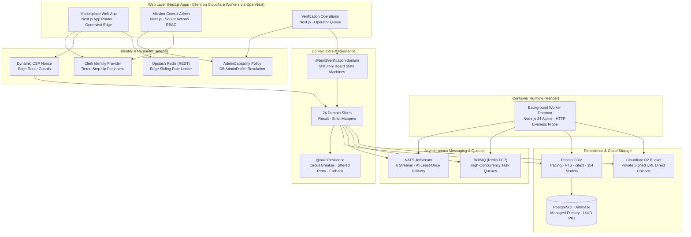
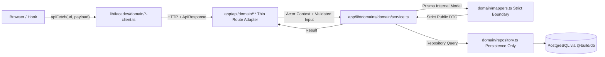
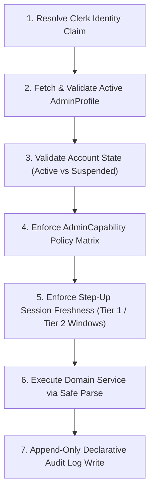
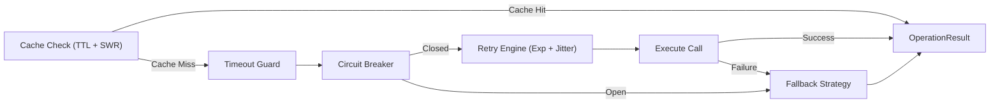
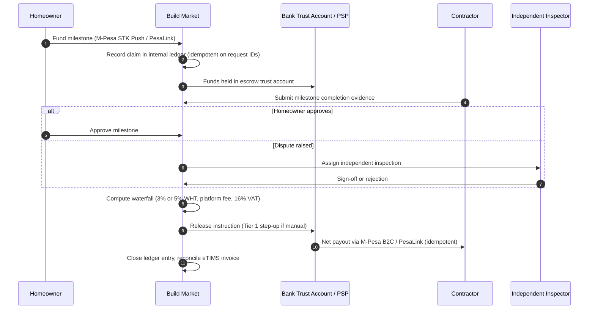
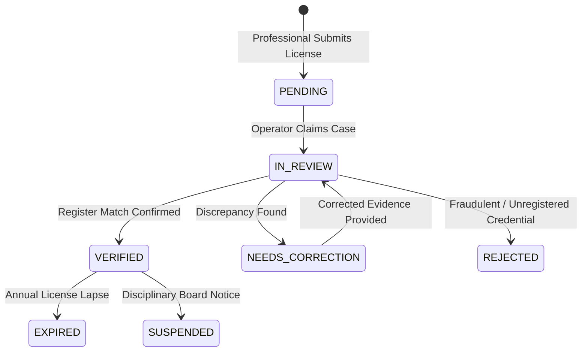
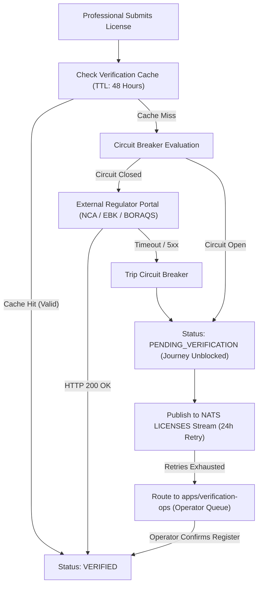

# Agent Execution Runbook: `donshammah.tech` (Astro 5 + Cloudflare Workers Static Assets)

> **Instructions for Autonomous Coding Agent:**
> You are tasked with scaffolding, building, and verifying a staff-level static portfolio, architectural case study, ADR index, and engineering blog for **Don Shammah** (`https://donshammah.tech`).
> Follow every step in this runbook sequentially. Do not introduce client-side UI frameworks (React/Vue) or runtime Mermaid JavaScript bundles. All pages must ship near-zero JS, compile Mermaid diagrams to inline SVG at build time, enforce strict security redactions, and pass all CI quality gates.

---

## 0. Architectural Constraints & Security Redaction Rules (MANDATORY)

Before creating any files, enforce these three non-negotiable constraints across all generated code and content:

1. **Zero Client-Side Mermaid Runtime:** All Mermaid diagrams in `.mdx` files must compile at build time via `rehype-mermaid` (`strategy: 'inline-svg'`).
2. **Public Attack-Surface Redaction Pass:**
   - **Strip Internal Ports:** Never expose internal dev or container port numbers (`:3500`, `:3005`, `:3501`, `:8080`, `:8080/healthz`) on public diagrams, topology cards, or prose. Replace them with runtime descriptors (`OpenNext Edge`, `Capability RBAC`, `Operator Queue`, `Container Daemon`, `HTTP Liveness Probe`).
   - **Generalize Step-Up Freshness Windows:** Never expose exact security countdown timers (`180s` / `300s` / `maxAgeSeconds: 180`) on public routes. Replace with `"Tier 1 / Tier 2 time-bounded freshness windows"` or `"strict short-lived re-authentication windows"`.
3. **Canonical Ownership:** All case studies, ADRs, and essays live natively in `src/content/`. Notion links must only appear as secondary `"Also on Notion"` mirror links.

---

## 1. Directory Structure to Scaffold

Create the following exact file tree:

```text
donshammah.tech/
├── .github/
│   └── workflows/
│       └── ci.yml
├── public/
│   ├── _headers
│   ├── _redirects
│   └── favicon.svg
├── src/
│   ├── components/
│   │   ├── ArchitectureDiagram.astro
│   │   ├── BaseHead.astro
│   │   ├── Callout.astro
│   │   ├── Footer.astro
│   │   └── Nav.astro
│   ├── content/
│   │   ├── work/
│   │   │   ├── build-market.mdx
│   │   │   └── build-market-architecture.mdx
│   │   ├── decisions/
│   │   │   ├── adr-001-clerk-identity-db-authority.mdx
│   │   │   ├── adr-002-layer-boundaries.mdx
│   │   │   ├── adr-003-vertical-domain-slicing.mdx
│   │   │   ├── adr-006-data-classification-replay.mdx
│   │   │   ├── adr-010-worker-daemon-isolation.mdx
│   │   │   ├── adr-admin-001-capability-auth.mdx
│   │   │   ├── adr-admin-008-declarative-audit-log.mdx
│   │   │   └── adr-admin-009-strangler-fig-flags.mdx
│   │   └── writing/
│   │       ├── why-we-ack-only-after-commit.mdx
│   │       ├── designing-around-flaky-regulator-portals.mdx
│   │       └── non-custodial-escrow-on-mpesa.mdx
│   ├── content.config.ts
│   ├── layouts/
│   │   ├── BaseLayout.astro
│   │   └── ProseLayout.astro
│   ├── pages/
│   │   ├── index.astro
│   │   ├── work/
│   │   │   └── build-market/
│   │   │       ├── index.astro
│   │   │       └── architecture.astro
│   │   ├── decisions/
│   │   │   ├── index.astro
│   │   │   └── [slug].astro
│   │   ├── writing/
│   │   │   ├── index.astro
│   │   │   └── [slug].astro
│   │   ├── og/
│   │   │   └── [...route].ts
│   │   └── rss.xml.ts
│   └── styles/
│       ├── global.css
│       └── prose.css
├── .htmlvalidate.json
├── astro.config.mjs
├── lighthouserc.json
├── package.json
├── tsconfig.json
└── wrangler.jsonc
```

---

## 2. Project Configuration Files

### 2.1 `package.json`

```json
{
  "name": "donshammah.tech",
  "type": "module",
  "version": "1.0.0",
  "private": true,
  "scripts": {
    "dev": "astro dev",
    "build": "astro check && astro build",
    "preview": "astro preview",
    "check:html": "html-validate 'dist/**/*.html'",
    "deploy": "wrangler deploy"
  },
  "dependencies": {
    "@astrojs/mdx": "^4.0.0",
    "@astrojs/rss": "^4.0.9",
    "@astrojs/sitemap": "^3.2.1",
    "astro": "^5.1.0",
    "astro-og-canvas": "^0.7.0",
    "canvaskit-wasm": "^0.39.1",
    "playwright": "^1.49.0",
    "rehype-autolink-headings": "^7.1.0",
    "rehype-mermaid": "^3.0.0",
    "rehype-slug": "^6.0.0",
    "remark-gfm": "^4.0.0",
    "sharp": "^0.33.5",
    "typescript": "^5.7.2"
  },
  "devDependencies": {
    "@astrojs/check": "^0.9.4",
    "@lhci/cli": "^0.14.0",
    "html-validate": "^9.1.0",
    "wrangler": "^3.99.0"
  }
}
```

### 2.2 `tsconfig.json`

```json
{
  "extends": "astro/tsconfigs/strict",
  "include": [".astro/types.d.ts", "**/*"],
  "exclude": ["dist"]
}
```

### 2.3 `astro.config.mjs`

```javascript
import { defineConfig } from "astro/config";
import mdx from "@astrojs/mdx";
import sitemap from "@astrojs/sitemap";
import rehypeSlug from "rehype-slug";
import rehypeAutolinkHeadings from "rehype-autolink-headings";
import rehypeMermaid from "rehype-mermaid";
import remarkGfm from "remark-gfm";

export default defineConfig({
  site: "https://donshammah.tech",
  output: "static",
  trailingSlash: "never",
  build: {
    format: "directory",
  },
  integrations: [
    mdx(),
    sitemap({
      filter: (page) => !page.includes("/og/"),
    }),
  ],
  markdown: {
    syntaxHighlight: {
      type: "shiki",
      excludeLangs: ["mermaid"],
    },
    shikiConfig: {
      themes: {
        light: "github-light-default",
        dark: "github-dark-default",
      },
    },
    remarkPlugins: [remarkGfm],
    rehypePlugins: [
      rehypeSlug,
      [rehypeAutolinkHeadings, { behavior: "wrap" }],
      [
        rehypeMermaid,
        {
          strategy: "inline-svg",
          dark: true,
          mermaidConfig: {
            theme: "base",
            themeVariables: {
              fontFamily: "DM Mono, ui-monospace, monospace",
              fontSize: "12px",
              primaryColor: "#18181c",
              primaryTextColor: "#f4f4f6",
              primaryBorderColor: "#60a5fa",
              lineColor: "#71717a",
              secondaryColor: "#101013",
              tertiaryColor: "#09090b",
            },
          },
        },
      ],
    ],
  },
});
```

### 2.4 `wrangler.jsonc`

```jsonc
{
  "$schema": "node_modules/wrangler/config-schema.json",
  "name": "donshammah-portfolio",
  "compatibility_date": "2026-10-01",
  "assets": {
    "directory": "./dist",
    "not_found_handling": "404-page",
  },
}
```

### 2.5 `.htmlvalidate.json`

```json
{
  "extends": ["html-validate:recommended"],
  "rules": {
    "no-inline-style": "off",
    "require-sri": "off",
    "no-trailing-whitespace": "off",
    "svg-focusable": "off"
  }
}
```

---

## 3. Content Collections Schema (`src/content.config.ts`)

```typescript
import { defineCollection, z } from "astro:content";
import { glob } from "astro/loaders";

const work = defineCollection({
  loader: glob({ pattern: "**/*.{md,mdx}", base: "./src/content/work" }),
  schema: z.object({
    title: z.string(),
    subtitle: z.string(),
    description: z.string(),
    role: z.string(),
    timeline: z.string(),
    status: z.string(),
    liveUrl: z.string().url(),
    notionMirrorUrl: z.string().url().optional(),
    readingTime: z.string(),
    stack: z.array(z.string()),
    updatedDate: z.coerce.date(),
  }),
});

const decisions = defineCollection({
  loader: glob({ pattern: "**/*.{md,mdx}", base: "./src/content/decisions" }),
  schema: z.object({
    adrId: z.string(),
    title: z.string(),
    description: z.string(),
    status: z
      .enum(["Ratified", "Superseded", "Deprecated"])
      .default("Ratified"),
    scope: z.enum(["apps/client", "apps/admin", "monorepo", "apps/workers"]),
    date: z.coerce.date(),
    tradeoff: z.string(),
    enforcedBy: z.string(),
  }),
});

const writing = defineCollection({
  loader: glob({ pattern: "**/*.{md,mdx}", base: "./src/content/writing" }),
  schema: z.object({
    title: z.string(),
    description: z.string(),
    pubDate: z.coerce.date(),
    updatedDate: z.coerce.date().optional(),
    readingTime: z.string(),
    tags: z.array(z.string()),
    relatedAdr: z.string().optional(),
    notionMirrorUrl: z.string().url().optional(),
    draft: z.boolean().default(false),
  }),
});

export const collections = { work, decisions, writing };
```

---

## 4. Design System & Styles (`src/styles/`)

### 4.1 `src/styles/global.css`

```css
/* ============ TOKENS ============ */
:root {
  --bg: #fafafa;
  --bg-2: #f4f4f5;
  --bg-3: #e8e8ec;
  --ink: #0a0a0c;
  --muted: #52525b;
  --hint: #8a8a94;
  --line: #e4e4e7;
  --line-2: #d4d4d8;
  --accent: #2563eb;
  --accent-2: #7c3aed;
  --accent-soft: rgba(37, 99, 235, 0.09);
  --ok: #16a34a;
  --ok-soft: rgba(22, 163, 74, 0.12);
  --glass: rgba(255, 255, 255, 0.72);
  --shadow:
    0 1px 2px rgba(0, 0, 0, 0.04), 0 12px 32px -12px rgba(0, 0, 0, 0.12);

  --mono: "DM Mono", ui-monospace, SFMono-Regular, Menlo, monospace;
  --display: "Fraunces", Georgia, serif;
  --sans: "Inter", system-ui, -apple-system, "Segoe UI", Roboto, sans-serif;

  --r-lg: 18px;
  --r-md: 12px;
  --r-sm: 8px;
  --ease: cubic-bezier(0.2, 0.7, 0.2, 1);
}
[data-theme="dark"] {
  --bg: #09090b;
  --bg-2: #101013;
  --bg-3: #18181c;
  --ink: #f4f4f6;
  --muted: #a1a1aa;
  --hint: #71717a;
  --line: #202024;
  --line-2: #2e2e34;
  --accent: #60a5fa;
  --accent-2: #a78bfa;
  --accent-soft: rgba(96, 165, 250, 0.1);
  --ok: #4ade80;
  --ok-soft: rgba(74, 222, 128, 0.12);
  --glass: rgba(16, 16, 19, 0.72);
  --shadow: 0 1px 2px rgba(0, 0, 0, 0.4), 0 20px 40px -16px rgba(0, 0, 0, 0.6);
}

/* ============ BASE ============ */
*,
*::before,
*::after {
  box-sizing: border-box;
  margin: 0;
  padding: 0;
}
html {
  scroll-behavior: smooth;
  scroll-padding-top: 6rem;
  background: var(--bg);
  -webkit-text-size-adjust: 100%;
}
body {
  font-family: var(--sans);
  color: var(--ink);
  background: var(--bg);
  line-height: 1.6;
  font-size: 15px;
  -webkit-font-smoothing: antialiased;
  transition:
    background-color 0.25s ease,
    color 0.25s ease;
  overflow-x: hidden;
}
a {
  color: inherit;
}
::selection {
  background: var(--accent);
  color: #fff;
}
:focus-visible {
  outline: 2px solid var(--accent);
  outline-offset: 3px;
  border-radius: 4px;
}

body::before {
  content: "";
  position: fixed;
  inset: 0;
  z-index: -2;
  pointer-events: none;
  background:
    radial-gradient(
      60rem 40rem at 85% -10%,
      color-mix(in srgb, var(--accent) 14%, transparent),
      transparent 60%
    ),
    radial-gradient(
      50rem 36rem at -10% 30%,
      color-mix(in srgb, var(--accent-2) 10%, transparent),
      transparent 60%
    );
}
body::after {
  content: "";
  position: fixed;
  inset: 0;
  z-index: -1;
  pointer-events: none;
  opacity: 0.035;
  background-image: url("data:image/svg+xml,%3Csvg xmlns='http://www.w3.org/2000/svg' width='160' height='160'%3E%3Cfilter id='n'%3E%3CfeTurbulence type='fractalNoise' baseFrequency='.9' numOctaves='2' stitchTiles='stitch'/%3E%3C/filter%3E%3Crect width='100%25' height='100%25' filter='url(%23n)'/%3E%3C/svg%3E");
}

.wrap {
  max-width: 1080px;
  margin: 0 auto;
  padding: 0 1.5rem;
}
section {
  padding: 4.5rem 0 0;
}

.sr-only {
  position: absolute;
  width: 1px;
  height: 1px;
  margin: -1px;
  overflow: hidden;
  clip: rect(0, 0, 0, 0);
  white-space: nowrap;
  border: 0;
}
.skip-link {
  position: fixed;
  top: -100px;
  left: 1rem;
  z-index: 9999;
  padding: 0.5rem 1rem;
  background: var(--accent);
  color: #fff;
  font: 500 12px var(--mono);
  border-radius: var(--r-sm);
  transition: top 0.2s;
}
.skip-link:focus {
  top: 1rem;
}

.progress {
  position: fixed;
  top: 0;
  left: 0;
  height: 2px;
  width: 100%;
  transform-origin: 0 50%;
  transform: scaleX(0);
  background: linear-gradient(90deg, var(--accent), var(--accent-2));
  z-index: 200;
}

.js .reveal {
  opacity: 0;
  transform: translateY(18px);
  transition:
    opacity 0.7s var(--ease),
    transform 0.7s var(--ease);
  transition-delay: var(--d, 0s);
}
.js .reveal.in {
  opacity: 1;
  transform: none;
}

/* ============ NAV ============ */
.nav {
  position: sticky;
  top: 14px;
  z-index: 100;
  margin: 14px auto 0;
  max-width: 1080px;
  width: calc(100% - 3rem);
  display: flex;
  align-items: center;
  justify-content: space-between;
  gap: 1rem;
  padding: 0.55rem 0.6rem 0.55rem 1.1rem;
  border: 1px solid var(--line-2);
  border-radius: 999px;
  background: var(--glass);
  -webkit-backdrop-filter: blur(16px) saturate(160%);
  backdrop-filter: blur(16px) saturate(160%);
  box-shadow: var(--shadow);
}
.nav-logo {
  font: 500 13px var(--mono);
  letter-spacing: 0.03em;
  text-decoration: none;
  display: flex;
  align-items: center;
  gap: 0.55rem;
}
.nav-logo .dot {
  width: 8px;
  height: 8px;
  border-radius: 50%;
  background: linear-gradient(135deg, var(--accent), var(--accent-2));
}
.nav-right {
  display: flex;
  align-items: center;
  gap: 0.35rem;
}
.nav-links {
  display: flex;
  gap: 0.15rem;
}
.nav-links a {
  font: 500 12px var(--sans);
  text-decoration: none;
  color: var(--muted);
  padding: 0.45rem 0.8rem;
  border-radius: 999px;
  transition:
    color 0.2s,
    background 0.2s;
}
.nav-links a:hover,
.nav-links a.active {
  color: var(--ink);
  background: var(--bg-3);
}
.icon-btn {
  width: 34px;
  height: 34px;
  border-radius: 50%;
  border: 0;
  background: transparent;
  color: var(--muted);
  display: inline-flex;
  align-items: center;
  justify-content: center;
  cursor: pointer;
  font-size: 17px;
  transition:
    background 0.2s,
    color 0.2s,
    transform 0.2s;
}
.icon-btn:hover {
  background: var(--bg-3);
  color: var(--ink);
}
.menu-btn {
  display: none;
}

/* ============ HERO ============ */
.hero {
  padding-top: 5rem;
  display: grid;
  grid-template-columns: 1.15fr 0.85fr;
  gap: 3rem;
  align-items: center;
}
.status {
  display: inline-flex;
  align-items: center;
  gap: 0.5rem;
  margin-bottom: 1.5rem;
  font: 500 11px var(--mono);
  letter-spacing: 0.06em;
  text-transform: uppercase;
  padding: 0.4rem 0.8rem 0.4rem 0.65rem;
  border-radius: 999px;
  background: var(--ok-soft);
  color: var(--ok);
}
.status i {
  width: 6px;
  height: 6px;
  border-radius: 50%;
  background: currentColor;
  animation: pulse 2.4s ease-in-out infinite;
}
@keyframes pulse {
  0%,
  100% {
    opacity: 1;
    transform: scale(1);
  }
  50% {
    opacity: 0.4;
    transform: scale(0.8);
  }
}

.hero h1 {
  font-family: var(--display);
  font-weight: 300;
  letter-spacing: -0.035em;
  line-height: 1;
  font-size: clamp(2.8rem, 7vw, 5rem);
  margin-bottom: 1.25rem;
}
.hero h1 em {
  font-style: italic;
  font-weight: 400;
  background: linear-gradient(100deg, var(--accent), var(--accent-2));
  -webkit-background-clip: text;
  background-clip: text;
  color: transparent;
}
.hero .role {
  font: 500 12px var(--mono);
  letter-spacing: 0.1em;
  text-transform: uppercase;
  color: var(--hint);
  margin-bottom: 1rem;
}
.hero .bio {
  color: var(--muted);
  font-size: 16px;
  line-height: 1.75;
  max-width: 34rem;
  margin-bottom: 2rem;
}

.cta {
  display: flex;
  flex-wrap: wrap;
  gap: 0.65rem;
  margin-bottom: 2rem;
}
.btn {
  display: inline-flex;
  align-items: center;
  gap: 0.5rem;
  text-decoration: none;
  cursor: pointer;
  font: 500 13px var(--sans);
  padding: 0.7rem 1.15rem;
  border-radius: 999px;
  border: 1px solid var(--line-2);
  background: transparent;
  color: var(--ink);
  transition:
    transform 0.2s var(--ease),
    border-color 0.2s,
    background 0.2s,
    box-shadow 0.2s;
}
.btn:hover {
  transform: translateY(-2px);
  border-color: var(--accent);
  background: var(--bg-2);
}
.btn.primary {
  background: var(--ink);
  color: var(--bg);
  border-color: var(--ink);
}
.btn.primary:hover {
  box-shadow: 0 10px 24px -8px color-mix(in srgb, var(--ink) 50%, transparent);
  background: var(--ink);
}
.btn i {
  font-size: 16px;
}

.tags {
  display: flex;
  flex-wrap: wrap;
  gap: 0.4rem;
}
.tag {
  font: 400 11px var(--mono);
  padding: 0.3rem 0.65rem;
  border: 1px solid var(--line-2);
  border-radius: 6px;
  color: var(--muted);
  background: var(--bg);
  transition:
    color 0.2s,
    border-color 0.2s;
}
.tag:hover {
  color: var(--ink);
  border-color: var(--accent);
}

.term {
  border: 1px solid var(--line-2);
  border-radius: var(--r-lg);
  background: var(--bg-2);
  box-shadow: var(--shadow);
  overflow: hidden;
  font-family: var(--mono);
  font-size: 12px;
}
.term-bar {
  display: flex;
  align-items: center;
  gap: 0.4rem;
  padding: 0.7rem 0.9rem;
  border-bottom: 1px solid var(--line);
}
.term-bar span {
  width: 9px;
  height: 9px;
  border-radius: 50%;
  background: var(--line-2);
}
.term-bar b {
  margin-left: auto;
  font-weight: 400;
  font-size: 10px;
  color: var(--hint);
  letter-spacing: 0.06em;
  text-transform: uppercase;
}
.term-body {
  padding: 1.1rem 1.1rem 1.25rem;
  line-height: 2;
  color: var(--muted);
}
.term-body .p {
  color: var(--accent);
}
.term-body .k {
  color: var(--ink);
}
.term-body .a {
  color: var(--accent-2);
}
.term-body .c {
  color: var(--hint);
}
.caret {
  display: inline-block;
  width: 7px;
  height: 14px;
  background: var(--accent);
  vertical-align: -2px;
  animation: blink 1.1s steps(2) infinite;
}
@keyframes blink {
  50% {
    opacity: 0;
  }
}

/* ============ SECTION HEAD & METRICS ============ */
.sec-head {
  display: flex;
  align-items: baseline;
  gap: 1rem;
  margin-bottom: 2rem;
}
.sec-head h2 {
  font-family: var(--display);
  font-weight: 300;
  font-size: clamp(1.8rem, 4vw, 2.6rem);
  letter-spacing: -0.025em;
  line-height: 1.1;
}
.sec-head .num {
  font: 400 11px var(--mono);
  color: var(--hint);
  letter-spacing: 0.1em;
}
.sec-head .rule {
  flex: 1;
  height: 1px;
  background: var(--line);
  align-self: center;
}

.metrics {
  display: grid;
  grid-template-columns: repeat(4, 1fr);
  border: 1px solid var(--line-2);
  border-radius: var(--r-lg);
  background: var(--bg-2);
  overflow: hidden;
  margin-top: 4rem;
}
.metric {
  padding: 1.5rem 1.5rem 1.35rem;
  border-right: 1px solid var(--line);
}
.metric:last-child {
  border-right: 0;
}
.metric strong {
  display: block;
  font: 300 2.4rem/1 var(--display);
  letter-spacing: -0.03em;
  margin-bottom: 0.4rem;
}
.metric span {
  font: 400 11px var(--mono);
  letter-spacing: 0.06em;
  text-transform: uppercase;
  color: var(--hint);
}

/* ============ CARDS & FEATURED ============ */
.card {
  position: relative;
  border: 1px solid var(--line-2);
  border-radius: var(--r-lg);
  background: var(--bg-2);
  transition:
    border-color 0.25s,
    transform 0.3s var(--ease),
    box-shadow 0.3s;
  overflow: hidden;
}
.card::before {
  content: "";
  position: absolute;
  inset: 0;
  pointer-events: none;
  opacity: 0;
  transition: opacity 0.3s;
  background: radial-gradient(
    360px circle at var(--mx, 50%) var(--my, 50%),
    color-mix(in srgb, var(--accent) 14%, transparent),
    transparent 60%
  );
}
.card:hover::before {
  opacity: 1;
}
.card:hover {
  border-color: color-mix(in srgb, var(--accent) 45%, var(--line-2));
  box-shadow: var(--shadow);
}
.card > * {
  position: relative;
}

.featured {
  padding: 2rem;
}
.f-top {
  display: flex;
  justify-content: space-between;
  align-items: center;
  gap: 1rem;
  flex-wrap: wrap;
  margin-bottom: 1.25rem;
}
.badges {
  display: flex;
  gap: 0.4rem;
  flex-wrap: wrap;
}
.badge {
  font: 500 10px var(--mono);
  letter-spacing: 0.08em;
  text-transform: uppercase;
  padding: 0.3rem 0.55rem;
  border-radius: 5px;
  background: var(--bg-3);
  color: var(--muted);
}
.badge.hot {
  background: var(--accent-soft);
  color: var(--accent);
}
.f-links {
  display: flex;
  gap: 0.4rem;
}
.circle-link {
  width: 36px;
  height: 36px;
  border-radius: 50%;
  border: 1px solid var(--line-2);
  display: inline-flex;
  align-items: center;
  justify-content: center;
  text-decoration: none;
  color: var(--muted);
  font-size: 16px;
  background: var(--bg);
  transition:
    transform 0.2s var(--ease),
    color 0.2s,
    border-color 0.2s;
}
.circle-link:hover {
  color: var(--ink);
  border-color: var(--accent);
  transform: translateY(-2px);
}

.featured h3 {
  font-family: var(--display);
  font-weight: 400;
  font-size: clamp(1.5rem, 3.4vw, 2.1rem);
  letter-spacing: -0.02em;
  line-height: 1.15;
  margin-bottom: 0.9rem;
  max-width: 40rem;
}
.f-desc {
  color: var(--muted);
  max-width: 46rem;
  margin-bottom: 2rem;
  line-height: 1.8;
}
.label {
  display: flex;
  align-items: center;
  gap: 0.5rem;
  font: 500 10px var(--mono);
  letter-spacing: 0.1em;
  text-transform: uppercase;
  color: var(--hint);
  margin-bottom: 0.8rem;
}

.diagram {
  border: 1px solid var(--line);
  border-radius: var(--r-md);
  background: var(--bg);
  padding: 1rem;
  margin-bottom: 2rem;
  overflow-x: auto;
}
.diagram svg {
  display: block;
  min-width: 640px;
  width: 100%;
  height: auto;
}
.diagram .box {
  fill: var(--bg-2);
  stroke: var(--line-2);
  stroke-width: 1;
}
.diagram .box.hl {
  stroke: var(--accent);
  fill: var(--accent-soft);
}
.diagram .t1 {
  font: 500 12px var(--mono);
  fill: var(--ink);
}
.diagram .t2 {
  font: 400 10px var(--mono);
  fill: var(--hint);
}
.diagram .lane {
  font: 500 9px var(--mono);
  fill: var(--hint);
  letter-spacing: 0.12em;
}
.diagram .edge {
  stroke: var(--line-2);
  stroke-width: 1.2;
  fill: none;
  stroke-dasharray: 4 4;
  animation: dash 1.6s linear infinite;
}
.diagram .edge.solid {
  stroke: var(--accent);
  stroke-dasharray: none;
  animation: none;
  opacity: 0.7;
}
@keyframes dash {
  to {
    stroke-dashoffset: -16;
  }
}
.diagram .arrow {
  fill: var(--accent);
  opacity: 0.8;
}

.topo {
  display: grid;
  grid-template-columns: repeat(4, 1fr);
  gap: 0.75rem;
  margin-bottom: 2rem;
}
.topo div {
  padding: 0.9rem;
  border: 1px solid var(--line);
  border-radius: var(--r-md);
  background: var(--bg);
}
.topo h4 {
  font: 500 12px var(--mono);
  display: flex;
  justify-content: space-between;
  gap: 0.5rem;
  margin-bottom: 0.4rem;
}
.topo h4 small {
  font-size: 9px;
  color: var(--hint);
  font-weight: 400;
}
.topo p {
  font-size: 12px;
  line-height: 1.55;
  color: var(--muted);
}

.hl-grid {
  display: grid;
  grid-template-columns: repeat(3, 1fr);
  gap: 0.75rem;
  margin-bottom: 2rem;
}
.hl {
  padding: 1.1rem;
  border: 1px solid var(--line);
  border-radius: var(--r-md);
  background: var(--bg);
  transition:
    border-color 0.2s,
    transform 0.25s var(--ease);
}
.hl:hover {
  border-color: var(--line-2);
  transform: translateY(-2px);
}
.hl i {
  font-size: 20px;
  color: var(--accent);
  display: block;
  margin-bottom: 0.7rem;
}
.hl h4 {
  font-size: 13px;
  font-weight: 600;
  margin-bottom: 0.3rem;
}
.hl p {
  font-size: 12.5px;
  line-height: 1.6;
  color: var(--muted);
}

.stack-groups {
  display: grid;
  grid-template-columns: repeat(3, 1fr);
  gap: 1.5rem;
  padding-top: 1.5rem;
  border-top: 1px solid var(--line);
}
.chips {
  display: flex;
  flex-wrap: wrap;
  gap: 0.35rem;
}
.chip {
  font: 400 11px var(--mono);
  padding: 0.25rem 0.6rem;
  border-radius: 5px;
  background: var(--bg-3);
  color: var(--muted);
}

.case-link {
  display: flex;
  justify-content: space-between;
  align-items: center;
  gap: 1rem;
  margin-top: 1rem;
  padding: 1.1rem 1.4rem;
  text-decoration: none;
}
.case-link .l {
  display: flex;
  align-items: center;
  gap: 0.9rem;
  min-width: 0;
}
.case-link .ic {
  width: 38px;
  height: 38px;
  flex-shrink: 0;
  border-radius: 10px;
  background: var(--bg-3);
  display: inline-flex;
  align-items: center;
  justify-content: center;
  font-size: 18px;
  color: var(--muted);
}
.case-link small {
  display: block;
  font: 500 10px var(--mono);
  letter-spacing: 0.08em;
  text-transform: uppercase;
  color: var(--hint);
}
.case-link strong {
  display: block;
  font-size: 14px;
  font-weight: 500;
  overflow: hidden;
  text-overflow: ellipsis;
  white-space: nowrap;
}
.case-link .r {
  font: 500 10px var(--mono);
  letter-spacing: 0.08em;
  text-transform: uppercase;
  color: var(--muted);
  display: flex;
  align-items: center;
  gap: 0.4rem;
  white-space: nowrap;
}

/* ============ DECISIONS, PROJECTS, SKILLS, ABOUT ============ */
.sec-head.sub {
  margin: 3.5rem 0 1.5rem;
  padding: 0;
}
.sec-head.sub h2 {
  font-size: clamp(1.4rem, 3vw, 1.9rem);
}
.decisions {
  display: grid;
  grid-template-columns: repeat(2, 1fr);
  gap: 1rem;
}
.decision {
  padding: 1.5rem;
  display: flex;
  flex-direction: column;
  gap: 0.7rem;
  text-decoration: none;
}
.decision i {
  font-size: 22px;
  color: var(--accent);
}
.decision h3 {
  font-family: var(--display);
  font-weight: 400;
  font-size: 1.2rem;
  letter-spacing: -0.015em;
  line-height: 1.2;
}
.decision p {
  font-size: 13px;
  line-height: 1.7;
  color: var(--muted);
}
.decision .tradeoff {
  margin-top: auto;
  padding-top: 0.8rem;
  border-top: 1px solid var(--line);
  font: 400 11px/1.6 var(--mono);
  color: var(--hint);
}
.decision .tradeoff b {
  color: var(--muted);
  font-weight: 500;
}

.projects {
  display: grid;
  grid-template-columns: repeat(3, 1fr);
  gap: 1rem;
}
.proj {
  padding: 1.5rem;
  display: flex;
  flex-direction: column;
  gap: 1.1rem;
  min-height: 100%;
}
.proj-head {
  display: flex;
  justify-content: space-between;
  align-items: center;
}
.proj-num {
  font: 400 11px var(--mono);
  color: var(--hint);
  letter-spacing: 0.08em;
}
.proj-links {
  display: flex;
  gap: 0.35rem;
  position: relative;
  z-index: 3;
}
.proj-links .circle-link {
  width: 30px;
  height: 30px;
  font-size: 14px;
}
.proj h3 {
  font-family: var(--display);
  font-weight: 400;
  font-size: 1.25rem;
  letter-spacing: -0.015em;
  line-height: 1.2;
  margin-bottom: 0.5rem;
}
.proj h3 a {
  text-decoration: none;
}
.proj h3 a::after {
  content: "";
  position: absolute;
  inset: 0;
  z-index: 2;
}
.proj p {
  font-size: 13px;
  line-height: 1.65;
  color: var(--muted);
}
.proj .chips {
  margin-top: auto;
}
.proj-body {
  flex: 1;
  display: flex;
  flex-direction: column;
  gap: 1.1rem;
}

.skills {
  display: grid;
  grid-template-columns: repeat(3, 1fr);
  gap: 1rem;
}
.skill-card {
  padding: 1.5rem;
}
.skill-card h3 {
  font: 500 11px var(--mono);
  letter-spacing: 0.1em;
  text-transform: uppercase;
  color: var(--hint);
  margin-bottom: 1rem;
  display: flex;
  align-items: center;
  gap: 0.5rem;
}
.skill-card h3 i {
  color: var(--accent);
  font-size: 16px;
}

.two {
  display: grid;
  grid-template-columns: 1fr 1fr;
  gap: 3rem;
}
.about-text {
  color: var(--muted);
  font-size: 15px;
  line-height: 1.85;
}
.about-text strong {
  color: var(--ink);
  font-weight: 500;
}

.timeline {
  position: relative;
  padding-left: 1.5rem;
  border-left: 1px solid var(--line-2);
}
.tl-item {
  position: relative;
  padding-bottom: 1.5rem;
}
.tl-item::before {
  content: "";
  position: absolute;
  left: calc(-1.5rem - 5px);
  top: 0.45rem;
  width: 9px;
  height: 9px;
  border-radius: 50%;
  background: var(--accent);
  box-shadow: 0 0 0 4px var(--accent-soft);
}
.tl-year {
  font: 400 11px var(--mono);
  color: var(--hint);
  letter-spacing: 0.06em;
}
.tl-role {
  font-size: 16px;
  font-weight: 600;
  margin: 0.2rem 0;
}
.tl-co {
  font-size: 13px;
  color: var(--muted);
  margin-bottom: 0.6rem;
}
.tl-note {
  font-size: 13px;
  color: var(--muted);
  line-height: 1.7;
}

.contact {
  text-align: center;
  padding: 4rem 2rem;
  background: var(--bg-2);
}
.contact h2 {
  font-family: var(--display);
  font-weight: 300;
  font-size: clamp(2rem, 5vw, 3.4rem);
  letter-spacing: -0.03em;
  line-height: 1.05;
  margin-bottom: 1rem;
}
.contact h2 em {
  font-style: italic;
  background: linear-gradient(100deg, var(--accent), var(--accent-2));
  -webkit-background-clip: text;
  background-clip: text;
  color: transparent;
}
.contact p {
  color: var(--muted);
  max-width: 30rem;
  margin: 0 auto 1.75rem;
}
.contact .cta {
  justify-content: center;
  margin-bottom: 0;
}

.toast {
  position: fixed;
  left: 50%;
  bottom: 1.5rem;
  transform: translate(-50%, 140%);
  opacity: 0;
  z-index: 1000;
  pointer-events: none;
  display: flex;
  align-items: center;
  gap: 0.5rem;
  padding: 0.65rem 1.1rem;
  border-radius: 10px;
  background: var(--ink);
  color: var(--bg);
  font: 500 12px var(--mono);
  transition:
    transform 0.35s var(--ease),
    opacity 0.3s;
}
.toast.show {
  transform: translate(-50%, 0);
  opacity: 1;
}
.toast i {
  color: var(--ok);
}

footer {
  margin-top: 4.5rem;
  padding: 1.5rem 0 2.5rem;
  border-top: 1px solid var(--line);
  display: flex;
  justify-content: space-between;
  align-items: center;
  gap: 1rem;
  flex-wrap: wrap;
  font: 400 11px var(--mono);
  color: var(--hint);
  letter-spacing: 0.04em;
}
footer nav {
  display: flex;
  gap: 1.25rem;
}
footer a {
  text-decoration: none;
  transition: color 0.2s;
}
footer a:hover {
  color: var(--ink);
}

@media (max-width: 900px) {
  .hero {
    grid-template-columns: 1fr;
    gap: 2.5rem;
    padding-top: 3.5rem;
  }
  .metrics {
    grid-template-columns: repeat(2, 1fr);
  }
  .metric:nth-child(2) {
    border-right: 0;
  }
  .metric:nth-child(-n + 2) {
    border-bottom: 1px solid var(--line);
  }
  .topo {
    grid-template-columns: repeat(2, 1fr);
  }
  .hl-grid,
  .stack-groups,
  .skills {
    grid-template-columns: 1fr 1fr;
  }
  .projects {
    grid-template-columns: 1fr 1fr;
  }
  .two {
    grid-template-columns: 1fr;
    gap: 3rem;
  }
}
@media (max-width: 680px) {
  .wrap {
    padding: 0 1.1rem;
  }
  .nav {
    width: calc(100% - 2.2rem);
  }
  .menu-btn {
    display: inline-flex;
  }
  .nav-links {
    position: absolute;
    top: calc(100% + 8px);
    left: 0;
    right: 0;
    flex-direction: column;
    gap: 0.15rem;
    padding: 0.6rem;
    background: var(--bg-2);
    border: 1px solid var(--line-2);
    border-radius: var(--r-lg);
    box-shadow: var(--shadow);
    opacity: 0;
    transform: translateY(-6px);
    pointer-events: none;
    transition:
      opacity 0.2s,
      transform 0.2s;
  }
  .nav-links.open {
    opacity: 1;
    transform: none;
    pointer-events: auto;
  }
  .nav-links a {
    padding: 0.75rem 1rem;
    font-size: 14px;
  }
  .featured {
    padding: 1.25rem;
  }
  .topo,
  .hl-grid,
  .stack-groups,
  .skills,
  .projects,
  .decisions {
    grid-template-columns: 1fr;
  }
  .case-link .r span {
    display: none;
  }
  .contact {
    padding: 3rem 1.25rem;
  }
  section {
    padding-top: 3.5rem;
  }
}
@media (prefers-reduced-motion: reduce) {
  html {
    scroll-behavior: auto;
  }
  *,
  *::before,
  *::after {
    animation: none !important;
    transition: none !important;
  }
  .js .reveal {
    opacity: 1;
    transform: none;
  }
}
```

### 4.2 `src/styles/prose.css`

```css
.prose-shell {
  display: grid;
  grid-template-columns: minmax(0, 1fr) 230px;
  gap: 3.5rem;
  align-items: start;
  padding-top: 3.5rem;
}

.prose-header {
  padding-bottom: 2rem;
  margin-bottom: 2.5rem;
  border-bottom: 1px solid var(--line);
}

.prose-eyebrow {
  display: flex;
  flex-wrap: wrap;
  align-items: center;
  gap: 0.65rem;
  font: 500 11px var(--mono);
  letter-spacing: 0.08em;
  text-transform: uppercase;
  color: var(--hint);
  margin-bottom: 1rem;
}

.prose-header h1 {
  font-family: var(--display);
  font-weight: 300;
  font-size: clamp(2.1rem, 4.5vw, 3.25rem);
  letter-spacing: -0.03em;
  line-height: 1.08;
  margin-bottom: 1rem;
}

.prose-subtitle {
  font-size: 17px;
  color: var(--muted);
  line-height: 1.7;
  max-width: 44rem;
}

.prose-meta-bar {
  display: flex;
  flex-wrap: wrap;
  justify-content: space-between;
  align-items: center;
  gap: 1rem;
  margin-top: 1.5rem;
  padding-top: 1.25rem;
  border-top: 1px solid var(--line);
  font: 400 12px var(--mono);
  color: var(--muted);
}

.notion-mirror {
  display: inline-flex;
  align-items: center;
  gap: 0.4rem;
  font: 400 11px var(--mono);
  color: var(--hint);
  text-decoration: none;
  padding: 0.35rem 0.75rem;
  border: 1px solid var(--line-2);
  border-radius: 999px;
  transition:
    color 0.2s,
    border-color 0.2s;
}
.notion-mirror:hover {
  color: var(--ink);
  border-color: var(--accent);
}

.prose {
  font-size: 15.5px;
  line-height: 1.8;
  color: var(--ink);
}
.prose h2 {
  font-family: var(--display);
  font-weight: 300;
  font-size: clamp(1.55rem, 3vw, 2.05rem);
  letter-spacing: -0.02em;
  margin: 3.25rem 0 1rem;
  padding-bottom: 0.5rem;
  border-bottom: 1px solid var(--line);
}
.prose h3 {
  font-family: var(--display);
  font-weight: 400;
  font-size: 1.28rem;
  margin: 2.25rem 0 0.75rem;
}
.prose h2 a,
.prose h3 a {
  text-decoration: none;
}
.prose p,
.prose ul,
.prose ol {
  margin-bottom: 1.25rem;
  color: var(--muted);
}
.prose strong {
  color: var(--ink);
  font-weight: 600;
}
.prose ul,
.prose ol {
  padding-left: 1.35rem;
}
.prose li {
  margin-bottom: 0.45rem;
}
.prose code:not(pre code) {
  font: 400 12.5px var(--mono);
  padding: 0.18rem 0.42rem;
  border-radius: 5px;
  background: var(--bg-3);
  color: var(--ink);
  border: 1px solid var(--line-2);
}
.prose pre {
  padding: 1.15rem 1.25rem;
  border-radius: var(--r-md);
  border: 1px solid var(--line-2);
  background: var(--bg-2) !important;
  overflow-x: auto;
  margin: 1.5rem 0;
  font: 400 12.5px/1.7 var(--mono);
}

.prose table {
  width: 100%;
  border-collapse: collapse;
  margin: 1.75rem 0;
  font: 400 13px/1.6 var(--sans);
  display: block;
  overflow-x: auto;
}
.prose th {
  font: 500 10.5px var(--mono);
  letter-spacing: 0.08em;
  text-transform: uppercase;
  color: var(--hint);
  text-align: left;
  padding: 0.75rem 0.9rem;
  background: var(--bg-2);
  border: 1px solid var(--line-2);
}
.prose td {
  padding: 0.75rem 0.9rem;
  border: 1px solid var(--line);
  color: var(--muted);
  vertical-align: top;
}

.prose svg[id^="mermaid-"] {
  display: block;
  width: 100%;
  max-width: 100%;
  height: auto;
  margin: 1.75rem 0;
  padding: 1.25rem;
  border: 1px solid var(--line-2);
  border-radius: var(--r-md);
  background: var(--bg-2);
}

.callout {
  margin: 1.75rem 0;
  padding: 1.1rem 1.3rem;
  border-left: 3px solid var(--accent);
  background: var(--bg-2);
  border-radius: 0 var(--r-md) var(--r-md) 0;
}
.callout-title {
  font: 500 11px var(--mono);
  letter-spacing: 0.08em;
  text-transform: uppercase;
  color: var(--accent);
  margin-bottom: 0.4rem;
  display: flex;
  align-items: center;
  gap: 0.4rem;
}

.toc {
  position: sticky;
  top: 5.5rem;
  padding-left: 1rem;
  border-left: 1px solid var(--line);
  font-size: 12px;
}
.toc-title {
  font: 500 10px var(--mono);
  letter-spacing: 0.1em;
  text-transform: uppercase;
  color: var(--hint);
  margin-bottom: 0.75rem;
}
.toc ul {
  list-style: none;
  display: flex;
  flex-direction: column;
  gap: 0.45rem;
}
.toc a {
  color: var(--muted);
  text-decoration: none;
  line-height: 1.4;
  transition: color 0.2s;
}
.toc a:hover {
  color: var(--accent);
}

@media (max-width: 960px) {
  .prose-shell {
    grid-template-columns: 1fr;
  }
  .toc {
    display: none;
  }
}
```

---

## 5. Components & Layouts (`src/components/`, `src/layouts/`)

### 5.1 `src/components/BaseHead.astro`

```astro
---
interface Props {
  title: string;
  description: string;
  ogImage?: string;
  articleDate?: Date;
}

const canonicalURL = new URL(Astro.url.pathname, Astro.site);
const {
  title,
  description,
  ogImage = new URL('/og/index.png', Astro.site).toString(),
  articleDate,
} = Astro.props;

const jsonLd = articleDate
  ? {
      '@context': 'https://schema.org',
      '@type': 'TechArticle',
      headline: title,
      description,
      datePublished: articleDate.toISOString(),
      author: {
        '@type': 'Person',
        name: 'Don Shammah',
        url: 'https://donshammah.tech/',
      },
    }
  : {
      '@context': 'https://schema.org',
      '@type': 'Person',
      name: 'Don Shammah',
      url: 'https://donshammah.tech/',
      jobTitle: 'Backend & Systems Engineer',
      email: 'mailto:hello@donshammah.tech',
      address: { '@type': 'PostalAddress', addressCountry: 'KE' },
      sameAs: [
        'https://github.com/donshammah96',
        'https://www.linkedin.com/in/donshammah',
      ],
      knowsAbout: [
        'Distributed systems',
        'Event-driven architecture',
        'TypeScript',
        'PostgreSQL',
        'NATS JetStream',
        'M-Pesa Daraja',
      ],
    };
---
<meta charset="UTF-8" />
<meta name="viewport" content="width=device-width, initial-scale=1.0" />
<title>{title}</title>

<link rel="canonical" href={canonicalURL} />
<meta name="robots" content="index, follow" />
<meta name="description" content={description} />
<meta name="author" content="Don Shammah" />
<meta name="theme-color" content="#09090b" media="(prefers-color-scheme: dark)" />
<meta name="theme-color" content="#fafafa" media="(prefers-color-scheme: light)" />
<meta name="color-scheme" content="dark light" />

<meta property="og:type" content={articleDate ? 'article' : 'website'} />
<meta property="og:url" content={canonicalURL} />
<meta property="og:title" content={title} />
<meta property="og:description" content={description} />
<meta property="og:image" content={ogImage} />

<meta name="twitter:card" content="summary_large_image" />
<meta name="twitter:site" content="@donshammah" />
<meta name="twitter:title" content={title} />
<meta name="twitter:description" content={description} />
<meta name="twitter:image" content={ogImage} />

<link rel="alternate" type="application/rss+xml" title="Don Shammah — Engineering Writing & ADRs" href={new URL('/rss.xml', Astro.site)} />
<link rel="icon" type="image/svg+xml" href="/favicon.svg" />

<link rel="preconnect" href="https://fonts.googleapis.com" />
<link rel="preconnect" href="https://fonts.gstatic.com" crossorigin />
<link rel="stylesheet" href="https://fonts.googleapis.com/css2?family=DM+Mono:wght@400;500&family=Fraunces:ital,opsz,wght@0,9..144,300;0,9..144,400;0,9..144,500;1,9..144,300;1,9..144,400&family=Inter:wght@400;500;600&display=swap" />
<link rel="stylesheet" href="https://cdn.jsdelivr.net/npm/@tabler/icons-webfont@3/dist/tabler-icons.min.css" />

<script type="application/ld+json" set:html={JSON.stringify(jsonLd)} />
```

### 5.2 `src/components/Nav.astro`

```astro
---
const pathname = Astro.url.pathname;
---
<header class="nav" id="nav">
  <a href="/" class="nav-logo" aria-label="Don Shammah — home">
    <span class="dot" aria-hidden="true"></span>don.shammah
  </a>
  <div class="nav-right">
    <nav class="nav-links" id="nav-links" aria-label="Primary">
      <a href="/work/build-market" class:list={[{ active: pathname.startsWith('/work') }]}>Case Study</a>
      <a href="/decisions" class:list={[{ active: pathname.startsWith('/decisions') }]}>ADRs</a>
      <a href="/writing" class:list={[{ active: pathname.startsWith('/writing') }]}>Writing</a>
      <a href="/#projects">Projects</a>
      <a href="/resume.pdf" target="_blank" rel="noopener">Resume</a>
    </nav>
    <button class="icon-btn" id="theme-toggle" type="button" aria-label="Toggle color theme">
      <i class="ti ti-sun" aria-hidden="true"></i>
    </button>
    <button class="icon-btn menu-btn" id="menu-btn" type="button" aria-label="Open menu" aria-expanded="false" aria-controls="nav-links">
      <i class="ti ti-menu-2" aria-hidden="true"></i>
    </button>
  </div>
</header>
```

### 5.3 `src/components/Footer.astro`

```astro
---
const year = new Date().getFullYear();
---
<footer>
  <span>© <span id="year">{year}</span> · Don Shammah</span>
  <nav aria-label="Footer">
    <a href="/work/build-market">Case Study</a>
    <a href="/decisions">ADRs</a>
    <a href="/writing">Writing</a>
    <a href="/rss.xml">RSS</a>
    <a href="https://github.com/donshammah96" target="_blank" rel="noopener noreferrer">GitHub</a>
    <a href="https://www.linkedin.com/in/donshammah" target="_blank" rel="noopener noreferrer">LinkedIn</a>
  </nav>
</footer>
```

### 5.4 `src/components/ArchitectureDiagram.astro` (Port-Redacted Inline SVG)

```astro
<div class="diagram" role="img" aria-label="Architecture diagram: client, admin and verification apps publish to NATS JetStream, which feeds background workers that integrate with Daraja, eTIMS and statutory registries. PostgreSQL persists state.">
  <svg viewBox="0 0 800 270" xmlns="http://www.w3.org/2000/svg" aria-hidden="true">
    <defs>
      <marker id="ah" viewBox="0 0 8 8" refX="7" refY="4" markerWidth="7" markerHeight="7" orient="auto"><path d="M0 0 L8 4 L0 8 z" class="arrow"/></marker>
    </defs>
    <text class="lane" x="20" y="14">EDGE · CLOUDFLARE WORKERS</text>
    <text class="lane" x="320" y="14">EVENT BUS</text>
    <text class="lane" x="590" y="14">BACKGROUND · RENDER</text>

    <rect class="box" x="20" y="28" width="190" height="56" rx="10"/>
    <text class="t1" x="36" y="52">apps/client</text><text class="t2" x="36" y="69">marketplace portal</text>
    <rect class="box" x="20" y="108" width="190" height="56" rx="10"/>
    <text class="t1" x="36" y="132">apps/admin</text><text class="t2" x="36" y="149">RBAC · audit log</text>
    <rect class="box" x="20" y="188" width="190" height="56" rx="10"/>
    <text class="t1" x="36" y="212">apps/verification-ops</text><text class="t2" x="36" y="229">regulatory review</text>

    <rect class="box hl" x="320" y="98" width="170" height="76" rx="10"/>
    <text class="t1" x="336" y="128">NATS JetStream</text><text class="t2" x="336" y="146">consumer groups</text><text class="t2" x="336" y="160">dead-letter queues</text>

    <rect class="box" x="320" y="204" width="170" height="44" rx="10"/>
    <text class="t1" x="336" y="231">PostgreSQL · Prisma</text>

    <rect class="box hl" x="590" y="28" width="190" height="76" rx="10"/>
    <text class="t1" x="606" y="58">apps/workers</text><text class="t2" x="606" y="76">Node 24 · BullMQ · Redis</text><text class="t2" x="606" y="90">liveness health probe</text>
    <rect class="box" x="590" y="168" width="190" height="76" rx="10"/>
    <text class="t1" x="606" y="198">External systems</text><text class="t2" x="606" y="216">Daraja · eTIMS</text><text class="t2" x="606" y="230">9 statutory registries</text>

    <path class="edge" d="M210 56 C 265 56, 265 125, 320 125" marker-end="url(#ah)"/>
    <path class="edge" d="M210 136 L 320 136" marker-end="url(#ah)"/>
    <path class="edge" d="M210 216 C 265 216, 265 150, 320 150" marker-end="url(#ah)"/>
    <path class="edge solid" d="M490 120 C 540 120, 540 66, 590 66" marker-end="url(#ah)"/>
    <path class="edge solid" d="M685 104 L 685 168" marker-end="url(#ah)"/>
    <path class="edge" d="M405 174 L 405 204"/>
  </svg>
</div>
```

### 5.5 `src/components/Callout.astro`

```astro
---
interface Props {
  title: string;
}
const { title } = Astro.props;
---
<aside class="callout">
  <div class="callout-title"><i class="ti ti-info-circle" aria-hidden="true"></i>{title}</div>
  <div class="callout-body"><slot /></div>
</aside>
```

### 5.6 `src/layouts/BaseLayout.astro`

```astro
---
import BaseHead from '../components/BaseHead.astro';
import Nav from '../components/Nav.astro';
import Footer from '../components/Footer.astro';
import '../styles/global.css';
import '../styles/prose.css';

interface Props {
  title: string;
  description: string;
  ogImage?: string;
  articleDate?: Date;
}

const { title, description, ogImage, articleDate } = Astro.props;
---
<!DOCTYPE html>
<html lang="en" data-theme="dark">
<head>
  <BaseHead
    title={title}
    description={description}
    ogImage={ogImage}
    articleDate={articleDate}
  />
  <script is:inline>
    (function () {
      var saved = null;
      try { saved = localStorage.getItem('theme'); } catch (e) {}
      var pref = window.matchMedia('(prefers-color-scheme: light)').matches ? 'light' : 'dark';
      document.documentElement.setAttribute('data-theme', saved || pref);
      document.documentElement.classList.add('js');
    })();
  </script>
</head>
<body>
  <a href="#main" class="skip-link">Skip to main content</a>
  <div class="progress" id="progress" aria-hidden="true"></div>

  <div id="toast" class="toast" role="status" aria-live="polite" aria-atomic="true">
    <i class="ti ti-check" aria-hidden="true"></i><span id="toast-msg">Copied</span>
  </div>

  <Nav />

  <main id="main" class="wrap">
    <slot />
    <Footer />
  </main>

  <script is:inline>
    'use strict';
    var $ = function (s, c) { return (c || document).querySelector(s); };
    var $$ = function (s, c) { return Array.prototype.slice.call((c || document).querySelectorAll(s)); };
    var reduce = window.matchMedia('(prefers-reduced-motion: reduce)').matches;

    (function () {
      var btn = $('#theme-toggle');
      if (!btn) return;
      var icon = $('i', btn);
      function apply(t, persist) {
        document.documentElement.setAttribute('data-theme', t);
        if (persist) { try { localStorage.setItem('theme', t); } catch (e) {} }
        icon.className = t === 'dark' ? 'ti ti-sun' : 'ti ti-moon';
        btn.setAttribute('aria-label', 'Switch to ' + (t === 'dark' ? 'light' : 'dark') + ' theme');
      }
      apply(document.documentElement.getAttribute('data-theme') || 'dark', false);
      btn.addEventListener('click', function () {
        apply(document.documentElement.getAttribute('data-theme') === 'dark' ? 'light' : 'dark', true);
      });
    })();

    (function () {
      var btn = $('#menu-btn'), links = $('#nav-links');
      if (!btn || !links) return;
      function set(open) {
        links.classList.toggle('open', open);
        btn.setAttribute('aria-expanded', String(open));
        $('i', btn).className = open ? 'ti ti-x' : 'ti ti-menu-2';
      }
      btn.addEventListener('click', function () { set(!links.classList.contains('open')); });
      $$('a', links).forEach(function (a) { a.addEventListener('click', function () { set(false); }); });
      document.addEventListener('keydown', function (e) { if (e.key === 'Escape') set(false); });
      document.addEventListener('click', function (e) { if (!e.target.closest('#nav')) set(false); });
    })();

    (function () {
      var bar = $('#progress'), ticking = false;
      if (!bar) return;
      function update() {
        var h = document.documentElement.scrollHeight - window.innerHeight;
        bar.style.transform = 'scaleX(' + (h > 0 ? Math.min(window.scrollY / h, 1) : 0) + ')';
        ticking = false;
      }
      window.addEventListener('scroll', function () { if (!ticking) { ticking = true; requestAnimationFrame(update); } }, { passive: true });
      update();
    })();

    (function () {
      var els = $$('.reveal');
      if (reduce || !('IntersectionObserver' in window)) { els.forEach(function (e) { e.classList.add('in'); }); return; }
      var io = new IntersectionObserver(function (entries) {
        entries.forEach(function (en) { if (en.isIntersecting) { en.target.classList.add('in'); io.unobserve(en.target); } });
      }, { threshold: 0.08, rootMargin: '0px 0px -6% 0px' });
      els.forEach(function (e) { io.observe(e); });
    })();

    (function () {
      if (reduce || !window.matchMedia('(hover: hover)').matches) return;
      $$('.card').forEach(function (c) {
        c.addEventListener('pointermove', function (e) {
          var r = c.getBoundingClientRect();
          c.style.setProperty('--mx', (e.clientX - r.left) + 'px');
          c.style.setProperty('--my', (e.clientY - r.top) + 'px');
        });
      });
    })();

    (function () {
      var btn = $('#copy-email'), toast = $('#toast'), msg = $('#toast-msg'), t;
      if (!btn || !toast) return;
      function show(m) { msg.textContent = m; toast.classList.add('show'); clearTimeout(t); t = setTimeout(function () { toast.classList.remove('show'); }, 2400); }
      btn.addEventListener('click', function () {
        var email = btn.getAttribute('data-email');
        if (navigator.clipboard && navigator.clipboard.writeText) {
          navigator.clipboard.writeText(email).then(function () { show('Email copied'); }, function () { window.location.href = 'mailto:' + email; });
        } else { window.location.href = 'mailto:' + email; }
      });
    })();
  </script>
</body>
</html>
```

### 5.7 `src/layouts/ProseLayout.astro`

```astro
---
import BaseLayout from './BaseLayout.astro';

interface Heading {
  depth: number;
  slug: string;
  text: string;
}

interface Props {
  title: string;
  subtitle?: string;
  description: string;
  eyebrow: string;
  readingTime?: string;
  notionMirrorUrl?: string;
  ogSlug: string;
  headings?: Heading[];
  articleDate?: Date;
}

const {
  title,
  subtitle,
  description,
  eyebrow,
  readingTime,
  notionMirrorUrl,
  ogSlug,
  headings = [],
  articleDate,
} = Astro.props;

const tocHeadings = headings.filter((h) => h.depth === 2);
const ogImage = new URL(`/og/${ogSlug}.png`, Astro.site).toString();
---
<BaseLayout title={`${title} — Don Shammah`} description={description} ogImage={ogImage} articleDate={articleDate}>
  <div class="prose-shell">
    <article>
      <header class="prose-header">
        <div class="prose-eyebrow">
          <span>{eyebrow}</span>
          {readingTime && <span>· {readingTime}</span>}
        </div>
        <h1>{title}</h1>
        {subtitle && <p class="prose-subtitle">{subtitle}</p>}
        <div class="prose-meta-bar">
          <slot name="meta" />
          {notionMirrorUrl && (
            <a href={notionMirrorUrl} target="_blank" rel="noopener noreferrer" class="notion-mirror">
              <i class="ti ti-brand-notion" aria-hidden="true"></i>Also on Notion ↗
            </a>
          )}
        </div>
      </header>
      <div class="prose">
        <slot />
      </div>
    </article>

    {tocHeadings.length > 0 && (
      <aside class="toc" aria-label="Table of contents">
        <div class="toc-title">On this page</div>
        <ul>
          {tocHeadings.map((h) => (
            <li><a href={`#${h.slug}`}>{h.text}</a></li>
          ))}
        </ul>
      </aside>
    )}
  </div>
</BaseLayout>
```

---

## 6. Pages & Dynamic Routes (`src/pages/`)

### 6.1 `src/pages/index.astro` (Ported & Redacted Landing Page)

Note that the featured Build Market card links directly to `/work/build-market` as the primary CTA and retains Notion as a secondary mirror icon. Internal ports and exact step-up second timings are redacted.

```astro
---
import BaseLayout from '../layouts/BaseLayout.astro';
import ArchitectureDiagram from '../components/ArchitectureDiagram.astro';
---
<BaseLayout
  title="Don Shammah — Backend & Systems Engineer"
  description="Backend and systems engineer building distributed, event-driven infrastructure. Creator and solo architect of Build Market, a construction marketplace for East Africa."
>
  <section class="hero" id="top" style="padding-top:5rem">
    <div>
      <div class="status reveal"><i aria-hidden="true"></i>Open to opportunities</div>
      <p class="role reveal" style="--d:.05s">Backend · Systems · Full-Stack</p>
      <h1 class="reveal" style="--d:.1s">Don <em>Shammah</em></h1>
      <p class="bio reveal" style="--d:.15s">I design backend systems that stay correct under failure. As the solo architect of Build Market, I built an event-driven construction and real estate platform for East Africa — statutory compliance state machines, milestone escrow, and capability-based security included.</p>
      <div class="cta reveal" style="--d:.2s">
        <a href="/work/build-market" class="btn primary"><i class="ti ti-Cpu" aria-hidden="true"></i>Read Case Study</a>
        <a href="#contact" class="btn"><i class="ti ti-mail" aria-hidden="true"></i>Get in touch</a>
        <a href="https://github.com/donshammah96" target="_blank" rel="noopener noreferrer" class="btn" aria-label="GitHub profile"><i class="ti ti-brand-github" aria-hidden="true"></i>GitHub</a>
        <a href="https://www.linkedin.com/in/donshammah" target="_blank" rel="noopener noreferrer" class="btn" aria-label="LinkedIn profile"><i class="ti ti-brand-linkedin" aria-hidden="true"></i>LinkedIn</a>
      </div>
      <ul class="tags reveal" style="--d:.25s; list-style:none" aria-label="Core technologies">
        <li class="tag">Node.js 24</li><li class="tag">TypeScript</li><li class="tag">NATS JetStream</li><li class="tag">BullMQ</li>
        <li class="tag">PostgreSQL</li><li class="tag">Prisma</li><li class="tag">Next.js 16</li><li class="tag">Cloudflare</li><li class="tag">M-Pesa Daraja</li>
      </ul>
    </div>

    <div class="term reveal" style="--d:.2s" aria-hidden="true">
      <div class="term-bar"><span></span><span></span><span></span><b>event-flow · illustrative</b></div>
      <div class="term-body">
        <div><span class="p">$</span> <span class="k">stream</span> follow BUILD_EVENTS</div>
        <div><span class="c">#</span> <span class="a">payment.confirmed</span> → escrow.hold</div>
        <div><span class="c">#</span> <span class="a">milestone.approved</span> → escrow.release</div>
        <div><span class="c">#</span> <span class="a">credential.submitted</span> → verify.registry</div>
        <div><span class="c">#</span> <span class="a">invoice.issued</span> → etims.reconcile</div>
        <div><span class="p">$</span> <span class="caret"></span></div>
      </div>
    </div>
  </section>

  <div class="metrics reveal" role="list" aria-label="Build Market at a glance">
    <div class="metric" role="listitem"><strong>4</strong><span>Apps in the monorepo</span></div>
    <div class="metric" role="listitem"><strong>9</strong><span>Statutory boards covered</span></div>
    <div class="metric" role="listitem"><strong>26</strong><span>Ratified ADRs</span></div>
    <div class="metric" role="listitem"><strong>47</strong><span>Counties covered</span></div>
  </div>

  <section id="projects" aria-labelledby="h-projects">
    <div class="sec-head reveal"><span class="num">01</span><h2 id="h-projects">Selected work</h2><div class="rule" aria-hidden="true"></div></div>

    <article class="card featured reveal" aria-labelledby="featured-name">
      <div class="f-top">
        <div class="badges">
          <span class="badge hot">Flagship system</span>
          <span class="badge">buildmarket.app</span>
          <span class="badge">Turborepo monorepo</span>
        </div>
        <div class="f-links">
          <a class="circle-link" href="/work/build-market" title="Read 2-minute case study" aria-label="Read Build Market 2-minute case study"><i class="ti ti-book" aria-hidden="true"></i></a>
          <a class="circle-link" href="https://buildmarket.app" target="_blank" rel="noopener noreferrer" title="Live platform" aria-label="Visit Build Market live platform"><i class="ti ti-external-link" aria-hidden="true"></i></a>
          <a class="circle-link" href="https://fascinated-piper-d98.notion.site/Build-Market-Architectural-Topography-Core-Systems-Design-37c3a344ec6780b9b509ffa6e9700869" target="_blank" rel="noopener noreferrer" title="Also on Notion" aria-label="Also on Notion"><i class="ti ti-brand-notion" aria-hidden="true"></i></a>
        </div>
      </div>

      <h3 id="featured-name">Build Market — construction &amp; real estate infrastructure</h3>
      <p class="f-desc">An event-driven marketplace, compliance engine, and project-coordination platform for Kenya's construction industry. It addresses offline trust gaps, uncertified contractors, and counterfeit materials through milestone-based escrow and statutory verification pipelines.</p>

      <div class="label"><i class="ti ti-topology-star-3" aria-hidden="true"></i>System architecture</div>
      <ArchitectureDiagram />

      <div class="label"><i class="ti ti-git-fork" aria-hidden="true"></i>Workspace topology</div>
      <div class="topo">
        <div><h4>apps/client <small>Edge BFF</small></h4><p>Edge-optimized portal for homeowners, professionals, and merchants. Cloudflare Workers via OpenNext.</p></div>
        <div><h4>apps/admin <small>Control Plane</small></h4><p>Capability-based RBAC, safeAction adapters, tiered step-up freshness guards, immutable audit log.</p></div>
        <div><h4>apps/verification-ops <small>Regulator Queue</small></h4><p>Credential review against NCA, EBK, BORAQS, EARB, EPRA, VRB, ISK, NEMA, and KEBS.</p></div>
        <div><h4>apps/workers <small>Container Daemon</small></h4><p>Node.js 24 Alpine daemon on Render with HTTP liveness probes, BullMQ, and NATS JetStream subscribers.</p></div>
      </div>

      <div class="hl-grid">
        <div class="hl"><i class="ti ti-certificate" aria-hidden="true"></i><h4>Statutory verification</h4><p>State machines verifying individual and firm credentials against nine statutory boards, with an operator fallback when registers are down.</p></div>
        <div class="hl"><i class="ti ti-device-mobile" aria-hidden="true"></i><h4>FinTech &amp; escrow</h4><p>Daraja 2.0 STK push, B2C disbursements, bank escrow trust model, and KRA eTIMS invoice reconciliation.</p></div>
        <div class="hl"><i class="ti ti-timeline" aria-hidden="true"></i><h4>Lifecycle &amp; BoQ engine</h4><p>Digital Bill of Quantities, staged milestones, inspection audits, and change-order controls.</p></div>
        <div class="hl"><i class="ti ti-building-store" aria-hidden="true"></i><h4>Materials commerce</h4><p>Multi-vendor directory across 21 categories with county-level fulfillment in all 47 counties.</p></div>
        <div class="hl"><i class="ti ti-network" aria-hidden="true"></i><h4>Distributed messaging</h4><p>JetStream streaming, consumer-group load balancing, BullMQ worker pools, and DLQs.</p></div>
        <div class="hl"><i class="ti ti-cloud-computing" aria-hidden="true"></i><h4>Edge &amp; cloud infra</h4><p>Cloudflare edge compute paired with containerized Render workers and Redis pipelines.</p></div>
      </div>

      <div class="stack-groups">
        <div><div class="label">Frontend &amp; edge</div><div class="chips">
          <span class="chip">Next.js 16</span><span class="chip">React 19</span><span class="chip">TypeScript</span><span class="chip">Cloudflare Workers</span><span class="chip">R2</span><span class="chip">Tailwind 4</span><span class="chip">Radix UI</span><span class="chip">TanStack Query</span></div></div>
        <div><div class="label">Backend &amp; infra</div><div class="chips">
          <span class="chip">Turborepo</span><span class="chip">Render</span><span class="chip">Node.js 24</span><span class="chip">NATS JetStream</span><span class="chip">BullMQ</span><span class="chip">Docker</span><span class="chip">Sharp</span><span class="chip">Blurhash</span></div></div>
        <div><div class="label">Data, payments &amp; security</div><div class="chips">
          <span class="chip">PostgreSQL</span><span class="chip">Prisma 7</span><span class="chip">Redis</span><span class="chip">M-Pesa Daraja</span><span class="chip">Clerk</span><span class="chip">OpenTelemetry</span><span class="chip">Datadog</span><span class="chip">Pino</span></div></div>
      </div>
    </article>

    <a class="card case-link reveal" href="/work/build-market" aria-label="Read the Build Market 2-minute case study and full architecture deep dive">
      <div class="l"><div class="ic" aria-hidden="true"><i class="ti ti-file-code"></i></div><div style="min-width:0"><small>2-minute executive summary + full deep dive</small><strong>Read the Build Market architectural case study</strong></div></div>
      <div class="r"><span>Read case study</span><i class="ti ti-arrow-right" aria-hidden="true"></i></div>
    </a>

    <div class="sec-head sub reveal"><h2 id="h-decisions">Engineering decisions &amp; essays</h2><div class="rule" aria-hidden="true"></div></div>
    <div class="decisions" role="list" aria-labelledby="h-decisions">
      <a class="card decision reveal" href="/writing/why-we-ack-only-after-commit" role="listitem">
        <i class="ti ti-checks" aria-hidden="true"></i>
        <h3>Acknowledge only after commit</h3>
        <p>Consumers call <code>ack()</code> only once the database transaction commits. A crash in between triggers redelivery, and idempotent upserts make the replay harmless, so nothing is lost or applied twice.</p>
        <div class="tradeoff"><b>Read essay →</b> Every handler must be idempotent.</div>
      </a>
      <a class="card decision reveal" style="--d:.06s" href="/writing/designing-around-flaky-regulator-portals" role="listitem">
        <i class="ti ti-route" aria-hidden="true"></i>
        <h3>Degrade, never block</h3>
        <p>When a regulator portal is down, a circuit breaker opens and the license moves to pending. A NATS retry stream keeps trying for 24 hours, with a human review queue as the last resort.</p>
        <div class="tradeoff"><b>Read essay →</b> Multi-stage regulator fallback.</div>
      </a>
      <a class="card decision reveal" href="/decisions/adr-admin-001-capability-auth" role="listitem">
        <i class="ti ti-shield-lock" aria-hidden="true"></i>
        <h3>Authority lives in the database</h3>
        <p>Admin capabilities resolve from a database profile on every mutation, never from token claims. Critical actions also require fresh step-up re-authentication within strict tiered freshness windows.</p>
        <div class="tradeoff"><b>Read ADR-ADMIN-001 →</b> One extra DB read per admin mutation.</div>
      </a>
      <a class="card decision reveal" style="--d:.06s" href="/writing/non-custodial-escrow-on-mpesa" role="listitem">
        <i class="ti ti-building-bank" aria-hidden="true"></i>
        <h3>Non-custodial escrow</h3>
        <p>Milestone funds sit in a licensed bank or PSP trust account, tracked by an internal claims ledger, with idempotent M-Pesa disbursements. The platform never commingles client money.</p>
        <div class="tradeoff"><b>Read essay →</b> Non-custodial M-Pesa Daraja 2.0 waterfall.</div>
      </a>
    </div>

    <div class="sec-head reveal" style="margin-top:4rem"><span class="num">02</span><h2 id="h-backend">Backend projects</h2><div class="rule" aria-hidden="true"></div></div>
    <div class="projects">
      <article class="card proj reveal">
        <div class="proj-head"><span class="proj-num">01</span>
          <div class="proj-links">
            <a class="circle-link" href="https://github.com/donshammah96/event-streaming" target="_blank" rel="noopener noreferrer" aria-label="Event Streaming Platform on GitHub"><i class="ti ti-brand-github" aria-hidden="true"></i></a>
            <a class="circle-link" href="https://event-streaming-gamma.vercel.app/" target="_blank" rel="noopener noreferrer" aria-label="Event Streaming Platform live demo"><i class="ti ti-external-link" aria-hidden="true"></i></a>
          </div></div>
        <div class="proj-body"><div><h3><a href="https://github.com/donshammah96/event-streaming" target="_blank" rel="noopener noreferrer">Event Streaming Platform</a></h3>
          <p>NATS-backed pub/sub with schema validation, consumer groups, dead-letter queues, and a dashboard for topic inspection and event replay.</p></div>
          <div class="chips"><span class="chip">NATS</span><span class="chip">TypeScript</span><span class="chip">PostgreSQL</span><span class="chip">Docker</span></div></div>
      </article>

      <article class="card proj reveal" style="--d:.06s">
        <div class="proj-head"><span class="proj-num">02</span>
          <div class="proj-links"><a class="circle-link" href="https://github.com/donshammah96/distributed-task-queue" target="_blank" rel="noopener noreferrer" aria-label="Distributed Task Queue on GitHub"><i class="ti ti-brand-github" aria-hidden="true"></i></a></div></div>
        <div class="proj-body"><div><h3><a href="https://github.com/donshammah96/distributed-task-queue" target="_blank" rel="noopener noreferrer">Distributed Task Queue</a></h3>
          <p>Fault-tolerant job scheduler with at-least-once delivery, BullMQ worker pools, and a pluggable backend interface.</p></div>
          <div class="chips"><span class="chip">TypeScript</span><span class="chip">BullMQ</span><span class="chip">Redis</span><span class="chip">Node.js</span></div></div>
      </article>

      <article class="card proj reveal" style="--d:.12s">
        <div class="proj-head"><span class="proj-num">03</span>
          <div class="proj-links"><a class="circle-link" href="https://github.com/donshammah96/api-gateway" target="_blank" rel="noopener noreferrer" aria-label="Type-Safe API Gateway on GitHub"><i class="ti ti-brand-github" aria-hidden="true"></i></a></div></div>
        <div class="proj-body"><div><h3><a href="https://github.com/donshammah96/api-gateway" target="_blank" rel="noopener noreferrer">Type-Safe API Gateway</a></h3>
          <p>Reverse proxy with tRPC routing, JWT auth, per-IP rate limiting via Upstash, and distributed tracing.</p></div>
          <div class="chips"><span class="chip">TypeScript</span><span class="chip">tRPC</span><span class="chip">Redis</span><span class="chip">AWS</span></div></div>
      </article>

      <article class="card proj reveal">
        <div class="proj-head"><span class="proj-num">04</span>
          <div class="proj-links"><a class="circle-link" href="https://github.com/donshammah96/ai-workflow-engine" target="_blank" rel="noopener noreferrer" aria-label="AI Workflow Engine on GitHub"><i class="ti ti-brand-github" aria-hidden="true"></i></a></div></div>
        <div class="proj-body"><div><h3><a href="https://github.com/donshammah96/ai-workflow-engine" target="_blank" rel="noopener noreferrer">AI Workflow Engine</a></h3>
          <p>LangChain orchestration for multi-step LLM pipelines with tool calling, memory management, and streaming via the Vercel AI SDK.</p></div>
          <div class="chips"><span class="chip">LangChain</span><span class="chip">Vercel AI SDK</span><span class="chip">PostgreSQL</span><span class="chip">Node.js</span></div></div>
      </article>

      <article class="card proj reveal" style="--d:.06s">
        <div class="proj-head"><span class="proj-num">05</span>
          <div class="proj-links"><a class="circle-link" href="https://github.com/donshammah96/resilience-library" target="_blank" rel="noopener noreferrer" aria-label="Resilience Library on GitHub"><i class="ti ti-brand-github" aria-hidden="true"></i></a></div></div>
        <div class="proj-body"><div><h3><a href="https://github.com/donshammah96/resilience-library" target="_blank" rel="noopener noreferrer">Resilience Library</a></h3>
          <p>Fault-tolerance primitives for Node.js: circuit breakers, exponential backoff with jitter, bulkheads, and timeout wrappers.</p></div>
          <div class="chips"><span class="chip">TypeScript</span><span class="chip">Node.js</span><span class="chip">Supabase</span></div></div>
      </article>

      <article class="card proj reveal" style="--d:.12s">
        <div class="proj-head"><span class="proj-num">06</span>
          <div class="proj-links"><a class="circle-link" href="https://github.com/donshammah96/observability-stack" target="_blank" rel="noopener noreferrer" aria-label="Observability Stack on GitHub"><i class="ti ti-brand-github" aria-hidden="true"></i></a></div></div>
        <div class="proj-body"><div><h3><a href="https://github.com/donshammah96/observability-stack" target="_blank" rel="noopener noreferrer">Observability Stack</a></h3>
          <p>Telemetry pipeline with structured NDJSON logging, correlation IDs, distributed tracing, and Grafana dashboards for SLOs.</p></div>
          <div class="chips"><span class="chip">OpenTelemetry</span><span class="chip">Grafana</span><span class="chip">AWS</span><span class="chip">Node.js</span></div></div>
      </article>
    </div>
  </section>

  <section id="skills" aria-labelledby="h-skills">
    <div class="sec-head reveal"><span class="num">03</span><h2 id="h-skills">Toolkit</h2><div class="rule" aria-hidden="true"></div></div>
    <div class="skills">
      <div class="card skill-card reveal"><h3><i class="ti ti-server-2" aria-hidden="true"></i>Backend</h3><div class="chips">
        <span class="chip">TypeScript</span><span class="chip">Node.js</span><span class="chip">tRPC</span><span class="chip">PostgreSQL</span><span class="chip">Prisma</span><span class="chip">Redis</span></div></div>
      <div class="card skill-card reveal" style="--d:.06s"><h3><i class="ti ti-arrows-shuffle" aria-hidden="true"></i>Distributed systems</h3><div class="chips">
        <span class="chip">NATS JetStream</span><span class="chip">BullMQ</span><span class="chip">Event-driven design</span><span class="chip">State machines</span><span class="chip">Idempotency</span><span class="chip">DLQs</span></div></div>
      <div class="card skill-card reveal" style="--d:.12s"><h3><i class="ti ti-cloud" aria-hidden="true"></i>Platform &amp; delivery</h3><div class="chips">
        <span class="chip">Next.js</span><span class="chip">Cloudflare Workers</span><span class="chip">Docker</span><span class="chip">Turborepo</span><span class="chip">OpenTelemetry</span><span class="chip">AWS</span></div></div>
    </div>
  </section>

  <section class="two" id="experience-about">
    <div id="experience">
      <div class="sec-head reveal"><span class="num">04</span><h2>Experience</h2><div class="rule" aria-hidden="true"></div></div>
      <div class="timeline reveal">
        <div class="tl-item">
          <time class="tl-year" datetime="2025">2025 — present</time>
          <h3 class="tl-role">Solo Software Engineer &amp; Founder</h3>
          <div class="tl-co">Build Market · Nairobi (Remote)</div>
          <p class="tl-note">Designed and built a construction and real estate marketplace for East Africa as a solo engineer. Turborepo monorepo with Next.js and tRPC, a NATS event bus for decoupled messaging, BullMQ/Redis for background jobs, Clerk for session auth, and M-Pesa APIs for local payments.</p>
        </div>
      </div>
    </div>

    <div id="about">
      <div class="sec-head reveal"><span class="num">05</span><h2>About</h2><div class="rule" aria-hidden="true"></div></div>
      <p class="about-text reveal">I'm a software engineer in my third year of building, focused on backend systems, clean architecture, and distributed infrastructure. I care about systems that are <strong>correct by design</strong> — not just fast, but sound under failure. Building Build Market alone taught me monorepo orchestration, event buses, and custom capability-based authorization the hard way.</p>
    </div>
  </section>

  <section id="contact" aria-labelledby="h-contact">
    <div class="card contact reveal">
      <h2 id="h-contact">Let's build something <em>dependable.</em></h2>
      <p>Open to backend, systems, and full-stack engineering roles.</p>
      <div class="cta">
        <button class="btn primary" id="copy-email" type="button" data-email="hello@donshammah.tech" aria-label="Copy email address hello@donshammah.tech to clipboard"><i class="ti ti-copy" aria-hidden="true"></i>hello@donshammah.tech</button>
        <a class="btn" href="mailto:hello@donshammah.tech"><i class="ti ti-mail" aria-hidden="true"></i>Send email</a>
        <a class="btn" href="https://www.linkedin.com/in/donshammah" target="_blank" rel="noopener noreferrer" aria-label="LinkedIn"><i class="ti ti-brand-linkedin" aria-hidden="true"></i>LinkedIn</a>
      </div>
    </div>
  </section>
</BaseLayout>
```

### 6.2 `src/pages/work/build-market/index.astro` (Layer 1 Route)

```astro
---
import { getEntry, render } from 'astro:content';
import ProseLayout from '../../../layouts/ProseLayout.astro';

const entry = await getEntry('work', 'build-market');
if (!entry) throw new Error('Missing build-market content entry');
const { Content, headings } = await render(entry);
---
<ProseLayout
  title={entry.data.title}
  subtitle={entry.data.subtitle}
  description={entry.data.description}
  eyebrow="Executive Case Study · Layer 1"
  readingTime={entry.data.readingTime}
  notionMirrorUrl={entry.data.notionMirrorUrl}
  ogSlug="work/build-market"
  headings={headings}
  articleDate={entry.data.updatedDate}
>
  <div slot="meta">
    <span><strong>Role:</strong> {entry.data.role}</span> · <span><strong>Status:</strong> {entry.data.status}</span>
  </div>
  <Content />
</ProseLayout>
```

### 6.3 `src/pages/work/build-market/architecture.astro` (Layer 2 Route)

```astro
---
import { getEntry, render } from 'astro:content';
import ProseLayout from '../../../layouts/ProseLayout.astro';

const entry = await getEntry('work', 'build-market-architecture');
if (!entry) throw new Error('Missing build-market-architecture content entry');
const { Content, headings } = await render(entry);
---
<ProseLayout
  title={entry.data.title}
  subtitle={entry.data.subtitle}
  description={entry.data.description}
  eyebrow="Systems Deep Dive · Layer 2"
  readingTime={entry.data.readingTime}
  notionMirrorUrl={entry.data.notionMirrorUrl}
  ogSlug="work/build-market-architecture"
  headings={headings}
  articleDate={entry.data.updatedDate}
>
  <div slot="meta">
    <a href="/work/build-market">← Back to 2-Minute Overview</a>
  </div>
  <Content />
</ProseLayout>
```

### 6.4 `src/pages/decisions/index.astro` & `src/pages/decisions/[slug].astro`

#### `src/pages/decisions/index.astro`

```astro
---
import { getCollection } from 'astro:content';
import BaseLayout from '../../layouts/BaseLayout.astro';

const decisions = (await getCollection('decisions')).sort((a, b) =>
  a.data.adrId.localeCompare(b.data.adrId)
);
---
<BaseLayout
  title="Architecture Decision Records (ADRs) — Don Shammah"
  description="Curated Architecture Decision Records governing layer boundaries, capability-based authorization, NATS JetStream consumers, and worker isolation in Build Market."
>
  <section style="padding-top: 3.5rem;">
    <div class="sec-head"><span class="num">ADR</span><h2>Architecture Decision Records</h2><div class="rule" aria-hidden="true"></div></div>
    <p style="color: var(--muted); max-width: 44rem; margin-bottom: 2.5rem;">
      On a solo engineering team there is no second human reviewer to catch a boundary violation. Every ADR below is paired with a mechanical enforcement gate in CI (AST boundary test, security drift scanner, or environment contract check).
    </p>
    <div class="decisions">
      {decisions.map((adr) => (
        <a class="card decision" href={`/decisions/${adr.id}`}>
          <div class="badges">
            <span class="badge hot">{adr.data.adrId}</span>
            <span class="badge">{adr.data.scope}</span>
            <span class="badge">{adr.data.status}</span>
          </div>
          <h3>{adr.data.title}</h3>
          <p>{adr.data.description}</p>
          <div class="tradeoff">
            <b>Enforced by:</b> {adr.data.enforcedBy}
          </div>
        </a>
      ))}
    </div>
  </section>
</BaseLayout>
```

#### `src/pages/decisions/[slug].astro`

```astro
---
import { getCollection, render } from 'astro:content';
import ProseLayout from '../../layouts/ProseLayout.astro';

export async function getStaticPaths() {
  const entries = await getCollection('decisions');
  return entries.map((entry) => ({
    params: { slug: entry.id },
    props: { entry },
  }));
}

const { entry } = Astro.props;
const { Content, headings } = await render(entry);
---
<ProseLayout
  title={`${entry.data.adrId}: ${entry.data.title}`}
  subtitle={entry.data.description}
  description={entry.data.description}
  eyebrow={`${entry.data.adrId} · ${entry.data.scope} · ${entry.data.status}`}
  ogSlug={`decisions/${entry.id}`}
  headings={headings}
  articleDate={entry.data.date}
>
  <div slot="meta">
    <a href="/decisions">← All ADRs</a> · <span><strong>Gate:</strong> {entry.data.enforcedBy}</span>
  </div>
  <Content />
</ProseLayout>
```

### 6.5 `src/pages/writing/index.astro` & `src/pages/writing/[slug].astro`

#### `src/pages/writing/index.astro`

```astro
---
import { getCollection } from 'astro:content';
import BaseLayout from '../../layouts/BaseLayout.astro';

const posts = (await getCollection('writing', ({ data }) => !data.draft)).sort(
  (a, b) => b.data.pubDate.valueOf() - a.data.pubDate.valueOf()
);
---
<BaseLayout
  title="Engineering Writing — Don Shammah"
  description="Essays on distributed systems, NATS JetStream delivery guarantees, resilient integrations with government registries, and M-Pesa escrow architecture."
>
  <section style="padding-top: 3.5rem;">
    <div class="sec-head"><span class="num">LOG</span><h2>Engineering Writing</h2><div class="rule" aria-hidden="true"></div></div>
    <p style="color: var(--muted); max-width: 44rem; margin-bottom: 2.5rem;">
      Focused essays on distributed systems, financial correctness, and building software that survives unreliable third-party infrastructure.
    </p>
    <div class="decisions">
      {posts.map((post) => (
        <a class="card decision" href={`/writing/${post.id}`}>
          <div class="badges">
            <span class="badge hot">{post.data.readingTime}</span>
            {post.data.tags.slice(0, 2).map((t) => <span class="badge">{t}</span>)}
          </div>
          <h3>{post.data.title}</h3>
          <p>{post.data.description}</p>
          <div class="tradeoff">
            <b>Published:</b> {post.data.pubDate.toISOString().slice(0, 10)}
          </div>
        </a>
      ))}
    </div>
  </section>
</BaseLayout>
```

#### `src/pages/writing/[slug].astro`

```astro
---
import { getCollection, render } from 'astro:content';
import ProseLayout from '../../layouts/ProseLayout.astro';

export async function getStaticPaths() {
  const posts = await getCollection('writing', ({ data }) => !data.draft);
  return posts.map((post) => ({
    params: { slug: post.id },
    props: { post },
  }));
}

const { post } = Astro.props;
const { Content, headings } = await render(post);
---
<ProseLayout
  title={post.data.title}
  subtitle={post.data.description}
  description={post.data.description}
  eyebrow={`Engineering Essay · ${post.data.pubDate.toISOString().slice(0, 10)}`}
  readingTime={post.data.readingTime}
  notionMirrorUrl={post.data.notionMirrorUrl}
  ogSlug={`writing/${post.id}`}
  headings={headings}
  articleDate={post.data.pubDate}
>
  <div slot="meta">
    <a href="/writing">← All Essays</a>
    {post.data.relatedAdr && (
      <span> · <a href={`/decisions/${post.data.relatedAdr}`}>Related ADR →</a></span>
    )}
  </div>
  <Content />
</ProseLayout>
```

### 6.6 `src/pages/og/[...route].ts` & `src/pages/rss.xml.ts`

#### `src/pages/og/[...route].ts`

```typescript
import { getCollection } from "astro:content";
import { OGImageRoute } from "astro-og-canvas";

const workEntries = await getCollection("work");
const decisionEntries = await getCollection("decisions");
const writingEntries = await getCollection("writing");

const pages: Record<string, { title: string; description: string }> = {
  index: {
    title: "Don Shammah — Backend & Systems Engineer",
    description:
      "Distributed, event-driven infrastructure that stays correct under failure. Creator of Build Market.",
  },
  ...Object.fromEntries(
    workEntries.map((entry) => [
      `work/${entry.id}`,
      { title: entry.data.title, description: entry.data.subtitle },
    ]),
  ),
  ...Object.fromEntries(
    decisionEntries.map((entry) => [
      `decisions/${entry.id}`,
      {
        title: `${entry.data.adrId}: ${entry.data.title}`,
        description: entry.data.description,
      },
    ]),
  ),
  ...Object.fromEntries(
    writingEntries.map((entry) => [
      `writing/${entry.id}`,
      { title: entry.data.title, description: entry.data.description },
    ]),
  ),
};

export const { getStaticPaths, GET } = OGImageRoute({
  param: "route",
  pages,
  getImageOptions: (_path, page) => ({
    title: page.title,
    description: page.description,
    bgGradient: [
      [9, 9, 11],
      [16, 16, 19],
    ],
    border: { color: [96, 165, 250], width: 8, side: "inline-start" },
    padding: 64,
    font: {
      title: {
        color: [244, 244, 246],
        size: 52,
        weight: "Normal",
      },
      description: {
        color: [161, 161, 170],
        size: 26,
      },
    },
  }),
});
```

#### `src/pages/rss.xml.ts`

```typescript
import rss from "@astrojs/rss";
import { getCollection } from "astro:content";
import type { APIContext } from "astro";

export async function GET(context: APIContext) {
  const writing = await getCollection("writing", ({ data }) => !data.draft);
  const decisions = await getCollection("decisions");

  return rss({
    title: "Don Shammah — Systems Engineering & ADRs",
    description:
      "Essays and Architecture Decision Records on distributed systems, event-driven backends, and Build Market.",
    site: context.site!,
    items: [
      ...writing.map((post) => ({
        title: post.data.title,
        pubDate: post.data.pubDate,
        description: post.data.description,
        link: `/writing/${post.id}`,
      })),
      ...decisions.map((adr) => ({
        title: `${adr.data.adrId}: ${adr.data.title}`,
        pubDate: adr.data.date,
        description: adr.data.description,
        link: `/decisions/${adr.id}`,
      })),
    ],
  });
}
```

---

## 7. Content Files (`src/content/`)

### 7.1 `src/content/work/build-market.mdx` (Layer 1: 2-Minute Case Study)

```mdx
---
title: "Build Market — Compliance-First Construction Infrastructure"
subtitle: "How I architected an event-driven construction marketplace, statutory verification engine, and non-custodial M-Pesa escrow platform for Kenya."
description: "2-minute architectural case study of Build Market: solving offline trust gaps, flaky statutory portals, and milestone escrow in East Africa."
role: "Sole Architect & Engineer (Product, Backend, Edge, Compliance)"
timeline: "2025 – Present"
status: "Live Production Pilot at buildmarket.app"
liveUrl: "https://buildmarket.app"
notionMirrorUrl: "https://fascinated-piper-d98.notion.site/Build-Market-Architectural-Topography-Core-Systems-Design-37c3a344ec6780b9b509ffa6e9700869"
readingTime: "2 min read"
stack:
  - "TypeScript"
  - "Next.js 16 (OpenNext)"
  - "Cloudflare Workers & R2"
  - "Node.js 24"
  - "NATS JetStream"
  - "BullMQ / Redis"
  - "PostgreSQL + Prisma 7"
  - "M-Pesa Daraja 2.0"
updatedDate: 2026-10-22
---

import Callout from "../../components/Callout.astro";
import ArchitectureDiagram from "../../components/ArchitectureDiagram.astro";

## The Problem

Construction in Kenya runs on fragile offline trust:

1. **Unverified practitioners:** Credentials across regulatory bodies (NCA, EBK, BORAQS) are claimed on paper rather than verified programmatically.
2. **Unprotected capital:** Homeowners and diaspora investors pay large upfront deposits with zero milestone protection if work stalls.
3. **Unreliable statutory infrastructure:** The government portals that confirm practicing licenses experience frequent downtime, timeouts, and unannounced schema drift.

## The Approach

**Build Market** operates strictly as a technology marketplace intermediary—never a general contractor. It connects property owners, registered professionals across 30+ trades, material suppliers, and independent dispute inspectors under an audit-logged, event-driven architecture.

<ArchitectureDiagram />

### The Three Hardest Engineering Problems

| Challenge                                          | Architectural Solution                                                                                                                                                                                      | Outcome                                                                                                 |
| :------------------------------------------------- | :---------------------------------------------------------------------------------------------------------------------------------------------------------------------------------------------------------- | :------------------------------------------------------------------------------------------------------ |
| **1. Reliability against flaky regulator portals** | 4-stage degradation pipeline: 48h verification cache → sliding-window circuit breaker → 24h NATS JetStream retry stream → two-approver human operator queue (`apps/verification-ops`).                      | User onboarding **never blocks** even when external NCA/EBK portals go offline.                         |
| **2. Money-movement correctness**                  | Non-custodial bank trust escrow paired with idempotent M-Pesa Daraja 2.0 flows (`[merchantRequestId, checkoutRequestId]`), deterministic NATS message IDs, and **acknowledge-only-after-commit** consumers. | Process crashes or network retries can never trigger a double disbursement.                             |
| **3. Architectural governance on a solo team**     | **26 ratified ADRs** enforced mechanically in CI via AST import-boundary tests, environment contract validators (75 keys), and an automated security drift scanner.                                         | **0 security drift findings** across 309 production files; strict `Adapter → Service → Repo` isolation. |

## System Scale at a Glance

- **Workspace Topology:** Turborepo monorepo with **4 isolated applications** (`client`, `admin`, `verification-ops`, `workers`) and **8 shared packages** (`db`, `verification-domain`, `nats`, `resilience`, `redis`, `types`, `ui`, `enums`).
- **Data Architecture:** **114 Prisma models**, **120 strict enums**, **24 vertical domain slices**, and Class A–D field-level data classification for Kenya DPA (2019) & GDPR compliance.
- **Event Spine:** **6 persistent NATS JetStream streams** (`VERIFICATION`, `USERS`, `ORDERS`, `PROJECTS`, `NOTIFICATIONS`, `LICENSES`) + isolated Node.js 24 BullMQ worker daemons.
- **Localized Rails:** All **47 Kenyan counties**, **9 statutory licensing authorities**, M-Pesa STK Push / PayBill / B2C, and KRA eTIMS fiscal invoice reconciliation.

<Callout title="Inspect Layer 2: Full Systems Deep Dive">
  Want to inspect the production TypeScript adapters, NATS consumer state
  machines, `safeAction` capability pipelines, threat matrices, and all 12
  sections of the architectural specification?
  <br />
  <br />
  <a href="/work/build-market/architecture" class="btn primary">
    Read Full Architectural Deep Dive (18 min) →
  </a>
</Callout>
```

### 7.2 `src/content/work/build-market-architecture.mdx` (Layer 2: Full Deep Dive, Reconciled & Redacted)

> **Agent Instruction:** Populate `src/content/work/build-market-architecture.mdx` with the complete `BUILD_MARKET_ARCHITECTURAL_CASE_STUDY.md` content, applying the frontmatter below and ensuring all 9 `AUTHOR`/`VERIFY`/`RECONCILE` comments are resolved and all internal ports (`:3500`, `:3005`, `:3501`, `:8080`) and exact step-up second timings (`180s/300s`) are redacted as follows:

````mdx
---
title: "Build Market — Architectural Topography & Core Systems Design"
subtitle: "Full systems specification: event-driven backend, non-custodial milestone escrow, statutory state machines, and mechanical ADR governance."
description: "Complete architectural deep-dive into Build Market's 4-app Turborepo monorepo, 114-model Prisma schema, NATS JetStream event spine, and Kenyan statutory integrations."
role: "Sole Architect & Engineer"
timeline: "2025 – Present · Updated October 2026"
status: "Live in production pilot at buildmarket.app"
liveUrl: "https://buildmarket.app"
notionMirrorUrl: "https://fascinated-piper-d98.notion.site/Build-Market-Architectural-Topography-Core-Systems-Design-37c3a344ec6780b9b509ffa6e9700869"
readingTime: "18 min read"
stack:
  - "TypeScript"
  - "Next.js 16 (OpenNext)"
  - "Cloudflare Workers"
  - "Node.js 24"
  - "PostgreSQL + Prisma"
  - "NATS JetStream"
  - "BullMQ"
  - "M-Pesa Daraja 2.0"
updatedDate: 2026-10-22
---

import Callout from "../../components/Callout.astro";

## Executive Summary

Build Market is an event-driven marketplace, project-coordination engine, and statutory compliance platform engineered to address the trust deficit, operational fragmentation, and rigorous regulatory requirements of the construction and real estate sectors in East Africa — specifically tailored for the Kenyan market.

The platform connects five distinct stakeholder classes — **property owners & developers** (individual homeowners, commercial developers, diaspora investors), **registered professionals** (architects, civil/structural engineers, quantity surveyors, physical planners, and 30+ trade categories), **materials suppliers & hardware stores** (building material distributors, equipment hire firms), **independent dispute inspectors**, and **statutory regulatory authorities** — under a unified, audit-logged ecosystem.

### The Problem, and Where the Design Answers It

| Real-world problem                                          | Consequence                                      | Design response                                                                  | Section      |
| ----------------------------------------------------------- | ------------------------------------------------ | -------------------------------------------------------------------------------- | ------------ |
| Credentials are claimed, not verified                       | Unqualified or fraudulent practitioners win work | Statutory verification state machine across 9 boards, with human review fallback | 3.2, 8       |
| Clients pay large deposits upfront                          | No recourse if work stalls or is substandard     | Milestone-gated, non-custodial bank escrow with transparent payout waterfall     | 3.1          |
| Government registers are slow, down, or change schema       | Onboarding blocks or fails                       | Cache, circuit breaker, async retry stream, operator queue                       | 8            |
| Platform could be mistaken for the contractor               | Regulatory and liability exposure                | Strict intermediary posture; verification badges are dated factual statements    | Philosophy 1 |
| Heavy handling of national IDs, KRA PINs, and phone numbers | Privacy and breach exposure                      | Class A–D data classification, zero-PII logging, 72-hour breach workflow         | 2.5, 5       |
| One engineer must keep a large system coherent              | Boundary erosion and drift                       | ADRs backed by AST checks and a drift scanner in CI                              | 4, 6         |

### Core Engineering Philosophy

1. **Statutory Intermediary Reality** — Under Kenyan law (_Engineers Act 2011_, _Cap 525 BORAQS Act_, _NCA Act 2011_), the platform operates strictly as a technology marketplace intermediary. Construction contracts remain bilateral (Homeowner–Contractor), inspection panels are independent, and verification badges are dated factual statements of register confirmation.
2. **Legacy Infrastructure Degradation** — Government statutory portals (NCA, EBK, BORAQS, KRA) experience frequent downtime and unannounced schema drift. The architecture treats external dependency failure as normal operating condition.
3. **Financial Correctness & Anti-Commingling** — Aligned with the _National Payment System Act (Cap 491B)_, _CBK NPS Regulations (2014)_, and the _Proceeds of Crime and Anti-Money Laundering (Amendment) Act, 2023 (POCAMLA)_, the platform enforces non-custodial escrow via licensed commercial bank trust accounts.
4. **Data Sovereignty & Provable Erasure** — Kenya's Data Protection Act (2019) and ODPC 2021 Regulations mandate strict field-level data classification (Class A–D), 72-hour breach notification playbooks, and tamper-evident export/anonymization pipelines.

<Callout title="Regulatory Notice">
  This case study describes engineering design decisions. Statutory references
  reflect the Kenyan regulatory landscape at the time of writing and do not
  constitute legal or tax advice.
</Callout>

---

## 1. Technical Architecture & Stack Justification

### 1.1 System Topography


````

**Edge-to-TCP Connectivity:** Because Cloudflare Workers execute in V8 isolates without persistent raw TCP pools, `apps/client` connects to PostgreSQL via **Cloudflare Hyperdrive and Prisma Driver Adapters**, enforces sliding-window rate limits over **Upstash Redis HTTP REST**, and dispatches NATS JetStream events and BullMQ jobs via authenticated internal BFF webhooks to the containerized `apps/workers` daemon on Render.

### 1.2 Alternatives Considered

| Decision                                                   | Alternative                       | Why this choice                                                                                        | Tradeoff accepted                                          |
| ---------------------------------------------------------- | --------------------------------- | ------------------------------------------------------------------------------------------------------ | ---------------------------------------------------------- |
| NATS JetStream for events **and** BullMQ for jobs          | One system for both               | Events are published and fanned out; jobs are stateful, delayed, and retried. Each tool fits one shape | Two systems to operate and monitor                         |
| Dedicated worker daemon (ADR-010)                          | Cron or long tasks inside Next.js | Image encoding and queue polling must not starve web threads                                           | An extra deployable and a liveness probe contract          |
| Capability auth resolved from the database (ADR-ADMIN-001) | Roles in Clerk JWT metadata       | JWT claims can be stale or revoked                                                                     | A database read on every admin mutation                    |
| Non-custodial escrow via licensed bank or PSP              | Holding client funds directly     | Avoids commingling and payment-system licensing exposure                                               | Dependence on a bank or PSP partner                        |
| Vertical domain slices in one monorepo (ADR-003)           | Separate services per domain      | One engineer, one deploy, with boundaries still enforced                                               | Discipline is enforced by static checks, not network walls |
| Strangler-fig with feature flags (ADR-ADMIN-009)           | Big-bang admin rewrite            | Incremental production verification and instant rollback                                               | Temporary duplicate routes and flag lifecycle management   |

---

## 2. Architectural Deep-Dives

### 2.1 Thin Route Adapters & Unidirectional Data Flow



### 2.2 Capability-Based Admin Security Model (`safeAction`)

`adminRole` is resolved from the database `AdminProfile` record on every single mutation. Claims inside Clerk JWT tokens can be stale or revoked; the database record represents the sole authoritative root of truth for administrative elevation.



| Freshness Tier        | Window Policy                     | Operations Governed                                                                                        | Failure Behavior                                                                  |
| --------------------- | --------------------------------- | ---------------------------------------------------------------------------------------------------------- | --------------------------------------------------------------------------------- |
| **Tier 1 — Critical** | Strict short-lived re-auth window | Role modifications, user suspension/deletion, manual financial reversals, escrow release, PII data exports | Throws `STEP_UP_AUTH_REQUIRED` modal prompting password/biometric re-verification |
| **Tier 2 — Elevated** | Elevated re-auth window           | Statutory license overrides, contractor category verification, dispute referee assignment                  | Throws `STEP_UP_AUTH_REQUIRED`                                                    |
| **Standard**          | Session Default                   | Read-only analytics, support ticket triage, content moderation                                             | Standard session expiration                                                       |

### 2.3 Event-Driven Orchestration with NATS JetStream

| Stream Name     | Subjects         | Retention Policy | Max Age  | Deduplication Window             | Purpose                                               |
| --------------- | ---------------- | ---------------- | -------- | -------------------------------- | ----------------------------------------------------- |
| `VERIFICATION`  | `verification.>` | Limits           | 7 days   | Server default                   | Contractor & property credential lifecycle tracking   |
| `USERS`         | `user.>`         | Limits           | 30 days  | Server default                   | Account lifecycle, consent records, profile updates   |
| `ORDERS`        | `order.>`        | Limits           | 90 days  | Server default                   | Materials purchase orders, BoQ checkouts, store items |
| `PROJECTS`      | `project.>`      | Limits           | 90 days  | Server default                   | Construction milestones, site sheets, change orders   |
| `NOTIFICATIONS` | `notification.>` | WorkQueue        | 24 hours | Server default                   | Transactional SMS (Africa's Talking), push, email     |
| `LICENSES`      | `license.>`      | Limits           | 30 days  | **Deterministic `msgId` window** | Statutory regulatory board checks & manual overrides  |

**The Invariant:** `msg.ack()` is invoked _only after_ the database transaction commits. Because all domain event handlers are designed with **idempotent upsert semantics**, redelivery after an ungraceful process crash produces zero inconsistent state.

### 2.4 Production Resilience Pipeline & Criticality Tiers



| Criticality Tier     | Target Operations                                 | Timeout  | Retry Strategy                      | Circuit Breaker Policy                  | Cache Strategy         |
| -------------------- | ------------------------------------------------- | -------- | ----------------------------------- | --------------------------------------- | ---------------------- |
| **Critical**         | Escrow releases, M-Pesa STK push, user bans       | 3,000ms  | 0 retries (fail fast)               | Threshold: 3 failures / 30s             | None                   |
| **Normal**           | Property search, contractor listings, store items | 5,000ms  | 3 attempts, exp backoff with jitter | Threshold: 5 failures / 60s             | 60s TTL, 30s SWR       |
| **Statutory Portal** | NCA, EBK, BORAQS, KRA registry checks             | 8,000ms  | 3 attempts + 24h NATS retry stream  | Threshold: 3 consecutive failures / 60s | 48h Verified Cache TTL |
| **Background**       | PDF BoQ compilation, analytics, catalog sync      | 15,000ms | 5 attempts with exp backoff         | Threshold: 10 failures / 120s           | 300s TTL               |

### 2.5 GDPR & Kenya Data Protection Act Compliance

| Data Class                        | Concrete Examples                                                | Structured Logs                  | Browser Storage | Audit Trail Persistence                    |
| --------------------------------- | ---------------------------------------------------------------- | -------------------------------- | --------------- | ------------------------------------------ |
| **Class A: Restricted**           | M-Pesa API secrets, Clerk signing keys, DB credentials           | **Prohibited**                   | **Prohibited**  | Never stored                               |
| **Class B: Sensitive PII**        | National ID, KRA PINs, phone numbers, email, GPS coordinates     | **Strictly Masked / Prohibited** | **Prohibited**  | Explicit opt-in only with retention limits |
| **Class C: Internal Operational** | UUID resource IDs, correlation IDs, capability flags, enums      | Allowed                          | Allowed         | Append-only audit records                  |
| **Class D: Public Domain**        | Verified business names, public portfolio photos, county regions | Allowed                          | Allowed         | Public read-replicas                       |

### 2.6 Direct-to-Cloud Asset Management Pipeline

```mermaid
sequenceDiagram
    autonumber
    participant Browser as Client Browser
    participant API as Next.js API Adapter
    participant S3 as Cloudflare R2 Bucket
    participant Worker as Background Worker Daemon

    Browser->>API: POST /api/uploads/signed-url (filename, mimeType, size)
    API->>API: Validate file type & size quota; generate signed token
    API-->>Browser: Signed Upload URL + Asset Tracking ID
    Browser->>S3: PUT [Binary Payload] directly to Signed URL
    S3-->>Browser: 200 OK (ETag returned)
    Browser->>API: POST /api/uploads/confirm (Asset ID, ETag)
    API->>Worker: Enqueue "asset.activate" task to BullMQ
    Worker->>S3: Validate upload, run malware check, generate WebP & Blurhash
    Worker->>API: Mark Asset status = ACTIVE
```

---

## 3. Localized Kenyan Ecosystem Integrations

### 3.1 M-Pesa Financial Integration & Non-Custodial Escrow

| Mode             | Purpose                                        | Prisma Model       | Idempotency Anchor                                         |
| ---------------- | ---------------------------------------------- | ------------------ | ---------------------------------------------------------- |
| `MPESA_STK_PUSH` | Homeowner milestone escrow funding             | `MpesaTransaction` | Unique composite: `[merchantRequestId, checkoutRequestId]` |
| `MPESA_PAYBILL`  | Direct merchant payments & deposit collections | `MpesaTransaction` | Unique: `[idempotencyKey]`                                 |
| `MPESA_B2C`      | Professional payouts upon milestone release    | `MpesaB2C`         | Unique composite: `[conversationId, transactionId]`        |

- **Shortcode & Float Custody:** The M-Pesa PayBill and B2C disbursement shortcodes are held under the regulated PSP / commercial bank escrow trust partner; Build Market holds API initiator credentials scoped to signed payout instructions, never custody of the underlying float.
- **High-Value Milestones (> KES 250,000):** While M-Pesa STK Push and B2C cap single transactions at KES 250,000, milestones exceeding that threshold route through **PesaLink or RTGS bank-to-trust transfers** using the same idempotent `EscrowClaim` ledger state machine.
- **Statutory Withholding Tax (WHT):** Under the _Kenya Income Tax Act (Cap 470, Third Schedule)_, resident WHT is dynamically calculated at **3%** for registered building/civil contractors and **5%** for professional/management consultancy services (`EBK`, `BORAQS`), alongside 16% VAT on the platform fee.



### 3.2 Statutory Licensing Authority State Machine



---

## 4. Architectural Decision Records & CI Drift Gates

| Test Suite                 | Execution Scope                        | Verification Target                                                                  |
| -------------------------- | -------------------------------------- | ------------------------------------------------------------------------------------ |
| **Policy Matrix Tests**    | `AdminRole × AdminCapability × Action` | Validates that unauthorized roles receive `forbidden` and cannot elevate privileges  |
| **Action Boundary Tests**  | AST static analysis across `actions/`  | Confirms zero direct Prisma imports and zero `.parse()` calls in adapter files       |
| **Domain Service Tests**   | Vitest unit tests                      | Validates business invariants, state machine transitions, and error codes            |
| **Contract & Drift Tests** | Custom validation scripts              | Asserts all 75 env keys match schemas and 0 security drift findings across 309 files |

---

## 5. Admin Overhaul & 12-Phase Strangler-Fig Evolution

| Phase         | Strategic Objective                             | Milestone Deliverables                                                                              | Status      |
| ------------- | ----------------------------------------------- | --------------------------------------------------------------------------------------------------- | ----------- |
| **Phase 0–2** | Structural Autopsy & ADR Foundation             | Ratified ADR-ADMIN-001 through 009; established strict env boundary; built drift detection tooling  | ✅ Complete |
| **Phase 3**   | Auth & Identity Hardening                       | Deployed `AdminActor` resolution; implemented `safeAction` pipeline with tiered freshness gates     | ✅ Complete |
| **Phase 4**   | Domain/Repository Layer Extraction              | Extracted 13 domain services returning `Result<T, DomainError>`; isolated repositories              | ✅ Complete |
| **Phase 5**   | Action Slice Migration                          | Migrated all actions to `safeAction`; eliminated raw `.parse()` calls                               | ✅ Complete |
| **Phase 6**   | Client Facade & DTO Mapper Standardization      | Enforced `mappers.ts` boundaries stripping Class A/B fields and converting Decimal/Date types       | ✅ Complete |
| **Phase 7–8** | Observability & Declarative Audit               | Implemented structured Zero-PII NDJSON logging; wired declarative `auditLog` into `safeAction`      | ✅ Complete |
| **Phase 9**   | Step-Up Session Freshness & Policy Matrix Suite | Automated `AdminRole × AdminCapability` permutation testing across all mutations                    | ✅ Complete |
| **Phase 10**  | Feature Flag Infrastructure                     | Built typed `AdminFeatureFlag` system for canary releases and zero-downtime rollbacks               | ✅ Complete |
| **Phase 11**  | Verification Console Extraction                 | Extracted regulatory review queue into `apps/verification-ops` with `@build/verification-domain`    | ✅ Complete |
| **Phase 12**  | ASVS L2 Security Hardening & Flag Retirement    | Mass-assignment elimination; CSP nonce headers; retired v2 flags; 0 drift findings across 309 files | ✅ Complete |

---

## 6. Designing for Legacy Unreliability



---

## 7. Engineering Retrospective: What I'd Do Differently

- **Enforce boundaries mechanically from day one.** Decomposing the early 952-line `shared.ts` (ADM-014) and running the v2 strangler migration were the cost of adding AST layer rules after the code existed.
- **Standardize `Result<T, E>` discriminants before the second domain slice.** Reconciling `ok` and `success` discriminants (ADM-016) across packages was avoidable churn.
- **Ship progressive onboarding before full KYC gates.** Early contractor feedback showed that asking for all statutory certificates on screen one caused drop-off; decoupling profile creation from asynchronous verification (`PENDING_VERIFICATION`) let professionals build their catalog immediately while verification ran in the background.

````

---

### 7.3 Curated ADRs (`src/content/decisions/*.mdx`)

Create the following 8 ADR files inside `src/content/decisions/`:

#### 1. `src/content/decisions/adr-001-clerk-identity-db-authority.mdx`
```mdx
---
adrId: "ADR-001"
title: "Clerk for Identity Authentication, PostgreSQL for Role Authority"
description: "Session tokens establish who the actor is; PostgreSQL profile records establish what the actor is permitted to do."
status: "Ratified"
scope: "monorepo"
date: 2026-01-18
tradeoff: "Requires transactional metadata synchronization on role changes, but prevents stale JWT privilege retention."
enforcedBy: "withAuth / safeAction actor resolution middleware"
---

## Context
Relying solely on third-party JWT custom claims for authorization creates a revocation window whenever a contractor's license is suspended or an operator's role changes.

## Decision
Clerk handles authentication and session freshness only. Every protected route and Server Action resolves the actor's authoritative role and capability set from PostgreSQL (`User` / `AdminProfile`).

## Consequences
Immediate revocation across all edge and container workers upon database state change.
````

#### 2. `src/content/decisions/adr-002-layer-boundaries.mdx`

```mdx
---
adrId: "ADR-002"
title: "Strict Layer Boundaries & Unidirectional Import Flow"
description: "HTTP route handlers and Server Actions are thin transport adapters that must never import Prisma directly."
status: "Ratified"
scope: "apps/client"
date: 2026-01-24
tradeoff: "More boilerplate per endpoint (Adapter → Service → Mapper → Repository) in exchange for zero business logic leakage and fast unit testing."
enforcedBy: "AST boundary test suite in CI"
---

## Context

When route handlers mix HTTP parsing, rate limiting, and raw Prisma queries, business invariants get duplicated across REST routes and Server Actions.

## Decision

Enforce a strict unidirectional import graph: `Facades → Route/Action Adapters → Domain Services → Mappers → Repositories → @build/db`. Adapters may only call `.safeParse()`, rate limiters, idempotency guards, and domain services.

## Consequences

Domain services can be tested in isolation without mocking Next.js `Request`/`Response` objects.
```

#### 3. `src/content/decisions/adr-003-vertical-domain-slicing.mdx`

```mdx
---
adrId: "ADR-003"
title: "Vertical Domain Slicing Over Horizontal Technical Layers"
description: "Organize domain logic into 24 isolated vertical slices communicating only via public service contracts or NATS events."
status: "Ratified"
scope: "apps/client"
date: 2026-02-02
tradeoff: "Cross-domain queries must go through explicit service facades rather than ad-hoc multi-domain SQL joins."
enforcedBy: "ESLint & AST import boundary checks"
---

## Context

A 114-model schema shared across properties, projects, verifications, escrow, and stores risks turning into a tightly coupled ball of mud.

## Decision

Partition business logic into 24 vertical slices (`properties`, `projects`, `verifications`, `escrow`, `licenses`, `gdpr`, etc.). Slices may never import another slice's `repository.ts`.

## Consequences

Each slice can evolve or be extracted into a standalone microservice (as we did with `apps/verification-ops`) without untangling cross-slice queries.
```

#### 4. `src/content/decisions/adr-006-data-classification-replay.mdx`

```mdx
---
adrId: "ADR-006"
title: "Class A–D Data Classification & Idempotency Replay Sanitization"
description: "Prevent Class A (Secrets) and Class B (Sensitive PII) fields from ever persisting in idempotency caches or structured logs."
status: "Ratified"
scope: "monorepo"
date: 2026-02-19
tradeoff: "Idempotency replay payloads must be stripped via strict DTO mappers before caching."
enforcedBy: "Zero-PII Pino log sanitizer + DTO mapper unit tests"
---

## Context

Under Kenya's Data Protection Act (2019) and GDPR, caching full API responses for idempotency or logging payloads can inadvertently leak National IDs, KRA PINs, or phone numbers into Redis and log aggregators.

## Decision

Classify all schema fields into Class A (Restricted), Class B (Sensitive PII), Class C (Operational UUIDs/Enums), and Class D (Public). Only Class C and D fields may enter idempotency replay stores or NDJSON logs.

## Consequences

Provable compliance with ODPC regulations and zero PII exposure in telemetry pipelines.
```

#### 5. `src/content/decisions/adr-010-worker-daemon-isolation.mdx`

```mdx
---
adrId: "ADR-010"
title: "Background Worker Daemon Isolation from Web Runtime"
description: "Offload NATS JetStream consumers, BullMQ queues, Sharp image encoding, and BoQ PDF compilation to a standalone Node.js 24 daemon."
status: "Ratified"
scope: "apps/workers"
date: 2026-03-05
tradeoff: "Requires managing a separate containerized deployment on Render alongside Cloudflare Workers."
enforcedBy: "Package dependency boundaries + container liveness probe"
---

## Context

Running CPU-heavy Sharp WebP/Blurhash generation, PDF generation, or long-lived NATS/Redis TCP consumers inside serverless web instances causes thread starvation and cold-start timeouts.

## Decision

Isolate all asynchronous consumers and BullMQ workers into `apps/workers` running on Node.js 24 Alpine containers with an HTTP liveness probe.

## Consequences

Web p95 latency remains predictable under heavy media upload or regulator retry spikes.
```

#### 6. `src/content/decisions/adr-admin-001-capability-auth.mdx`

```mdx
---
adrId: "ADR-ADMIN-001"
title: "Capability-Based Admin Authorization & Tiered Step-Up Freshness"
description: "Why administrative mutations resolve permissions from a database AdminProfile on every request and require step-up re-authentication."
status: "Ratified"
scope: "apps/admin"
date: 2026-03-14
tradeoff: "Incurs one indexed PostgreSQL lookup per administrative mutation in exchange for instant revocation and zero stale-JWT privilege escalation."
enforcedBy: "pnpm run admin:report-security-drift:strict (0 findings across 309 files)"
---

## Context

Checking coarse role strings (`if (role === "ADMIN")`) in session tokens leaves administrative surfaces vulnerable to stale tokens and privilege creep.

## Decision

1. Resolve `AdminActor` and `AdminRole` from the database `AdminProfile` on every mutation inside `safeAction`.
2. Enforce granular `AdminCapability` checks (`OVERRIDE_VERIFICATION`, `RELEASE_ESCROW`).
3. Require recent re-authentication within strict Tier 1 or Tier 2 freshness windows for high-risk mutations.

## Consequences

Suspending an `AdminProfile` revokes authority across the entire platform immediately.
```

#### 7. `src/content/decisions/adr-admin-008-declarative-audit-log.mdx`

```mdx
---
adrId: "ADR-ADMIN-008"
title: "Declarative Audit Logging Inside safeAction"
description: "Eliminate manual audit-log omission bugs by making audit metadata a required declarative property of high-risk action definitions."
status: "Ratified"
scope: "apps/admin"
date: 2026-04-02
tradeoff: "Every administrative mutation must declare its LegalBasis and target resource descriptor."
enforcedBy: "TypeScript compiler contract on safeAction + security drift scanner"
---

## Context

When developers must remember to call `auditService.log()` manually at the end of every mutation, edge-case code paths inevitably miss audit entries.

## Decision

Embed declarative `auditLog` configuration directly into the `safeAction` wrapper options. The wrapper writes the append-only `AuditLog` record (with `LegalBasis` and Class C/D diff metadata) before returning success to the caller.

## Consequences

100% audit coverage across all administrative and verification-ops mutations.
```

#### 8. `src/content/decisions/adr-admin-009-strangler-fig-flags.mdx`

```mdx
---
adrId: "ADR-ADMIN-009"
title: "Strangler-Fig Migrations via Typed Feature Flags with Expiry Governance"
description: "Migrate legacy administrative verticals behind typed feature flags enforced by automated CI expiration checks."
status: "Ratified"
scope: "apps/admin"
date: 2026-04-19
tradeoff: "Temporary route duplication during migration phases, offset by zero-downtime cutovers and automated flag cleanup."
enforcedBy: "pnpm run admin:check-governance"
---

## Context

Rewriting `apps/admin` to enforce ASVS L2 security controls in a single big-bang branch would stall delivery and risk production regressions.

## Decision

Introduce typed `AdminFeatureFlag` gates with mandatory owner and expiration metadata. Migrate `/users`, `/verifications`, and `/audit` slices incrementally, then retire the flags once production parity is verified.

## Consequences

All 12 overhaul phases completed with zero downtime, and all temporary v2 flags were cleanly retired on schedule.
```

---

### 7.4 Focused Engineering Essays (`src/content/writing/*.mdx`)

#### 1. `src/content/writing/why-we-ack-only-after-commit.mdx`

````mdx
---
title: "Why We Acknowledge NATS Messages Only After the Database Transaction Commits"
description: "How ordering your broker ack() after your PostgreSQL commit—and designing every handler as an idempotent upsert—eliminates silent data loss and double-payouts."
pubDate: 2026-10-15
readingTime: "4 min read"
tags: ["NATS JetStream", "Distributed Systems", "PostgreSQL", "Idempotency"]
relatedAdr: "adr-010-worker-daemon-isolation"
notionMirrorUrl: "https://fascinated-piper-d98.notion.site/Build-Market-Architectural-Topography-Core-Systems-Design-37c3a344ec6780b9b509ffa6e9700869"
---

When building an event-driven financial and compliance system like **Build Market**, the most dangerous failure mode isn't a crashed worker container—it is a crashed worker container that already told the message broker it succeeded, or one that repeats a non-idempotent side effect on restart.

## The Two Deadly Ordering Bugs

1. **Auto-Ack on Receive (At-Most-Once):** If you acknowledge a message as soon as it arrives and the Node.js process hits an OOM or network drop before PostgreSQL commits, that milestone approval or license verification event is lost silently.
2. **Ack After Non-Idempotent Write:** If you commit to the database, and the worker crashes _10 milliseconds before_ `msg.ack()` reaches the NATS server, JetStream will redeliver the message after `ack_wait` expires. If your database handler uses a blind `INSERT` or increments a balance (`balance = balance + amount`), redelivery corrupts your ledger.

## The Invariant: Commit First, Ack Second, Upsert Always

In Build Market, consumers never touch raw NATS primitives directly. Our `@build/nats` consumer wrapper enforces a strict lifecycle:

```typescript
export async function handleJetStreamMessage<T>(
  msg: JsMsg,
  schema: ZodSchema<T>,
  handler: (payload: T, ctx: TraceContext) => Promise<void>,
) {
  const parsed = schema.safeParse(JSON.parse(msg.string()));
  if (!parsed.success) {
    msg.term(); // Poison-pill termination: never retry schema-invalid JSON
    return;
  }

  try {
    const heartbeat = setInterval(() => msg.working(), 10_000);
    try {
      await handler(parsed.data, extractTraceContext(msg.headers));
    } finally {
      clearInterval(heartbeat);
    }

    // Acknowledge ONLY after the DB transaction has durably committed
    msg.ack();
  } catch (err) {
    if (msg.info.redeliveryCount >= MAX_DELIVERIES) {
      await publishToDeadLetterStream(msg, err);
      msg.term();
    } else {
      msg.nak(calculateExponentialJitter(msg.info.redeliveryCount));
    }
  }
}
```
````

## Pairing Consumer Upserts with Content-Addressed `msgId`

On the producer side, publishing to our `LICENSES` or `PROJECTS` streams attaches a deterministic `msgId`:

```typescript
const msgId = `${licenseId}-verify-${verificationAttemptNumber}`;
await producer.publishWithRetry("license.auto_verified", payload, { msgId });
```

Within JetStream's deduplication window, retry storms from upstream callers are silently dropped by the broker. And if a worker crashes between the database commit and `msg.ack()`, the handler is keyed on composite unique constraints (`@@unique([authority, licenseNumber])` or `[conversationId, transactionId]`), turning the replay into a harmless no-op.

````

#### 2. `src/content/writing/designing-around-flaky-regulator-portals.mdx`
```mdx
---
title: "Designing Around Flaky Regulator Portals: Cache, Circuit Breaker, Stream, Operator"
description: "How Build Market verifies contractor licenses against 9 Kenyan statutory boards without ever blocking user onboarding when government portals go down."
pubDate: 2026-10-18
readingTime: "5 min read"
tags: ["Resilience", "Circuit Breaker", "NATS JetStream", "State Machines"]
relatedAdr: "adr-003-vertical-domain-slicing"
notionMirrorUrl: "https://fascinated-piper-d98.notion.site/Build-Market-Architectural-Topography-Core-Systems-Design-37c3a344ec6780b9b509ffa6e9700869"
---

If you build software in East Africa that depends on statutory registers—NCA for contractors, EBK for engineers, BORAQS for architects and quantity surveyors, or KRA for tax compliance—you quickly learn one rule: **you cannot put a synchronous government portal call in the middle of a user's signup flow.**

Portals time out, maintenance windows happen unannounced, and HTML/JSON schemas shift without warning. Yet skipping verification defeats the core value proposition of a compliance-first marketplace.

## The 4-Stage Graceful Degradation Pipeline

Instead of a binary pass/fail HTTP call, Build Market models credential verification as an asynchronous state machine backed by four layers of defense:

1. **48-Hour Verification Cache:** If a practicing license was confirmed within the last 48 hours, we serve the cached verification immediately.
2. **Sliding-Window Circuit Breaker (`@build/resilience`):** If an external board times out 3 consecutive times within 60 seconds, the circuit breaker trips open. Subsequent requests fail fast in `<1ms` instead of hanging web threads for 8 seconds.
3. **24-Hour NATS JetStream Retry Stream:** When a portal is unreachable, the professional's credential transitions to `PENDING_VERIFICATION`—allowing them to finish onboarding and configure their profile—while a durable job on the `LICENSES` stream retries with exponential backoff and jitter for up to 24 hours.
4. **Human Operator Fallback (`apps/verification-ops`):** If retries exhaust or a discrepancy is detected, the case routes to our dedicated operator console with duplicate-license detection and two-approver sign-off controls.

## Why Heartbeats (`msg.working()`) Matter for Slow Portals

When a statutory portal is degraded but not completely down, responses can take 6–12 seconds. Without intervention, NATS JetStream might assume the consumer died and redeliver the message to another worker, amplifying load against an already struggling regulator endpoint.

Our consumer loop emits `msg.working()` heartbeats while awaiting the external response, extending the broker's `ack_wait` lease cleanly until the check resolves or hits our hard timeout guard.
````

#### 3. `src/content/writing/non-custodial-escrow-on-mpesa.mdx`

```mdx
---
title: "Architecting Non-Custodial Milestone Escrow on M-Pesa Daraja 2.0"
description: "How we combined bank trust accounts, composite idempotency anchors, and automated WHT/eTIMS waterfalls to protect construction capital in Kenya."
pubDate: 2026-10-20
readingTime: "5 min read"
tags: ["FinTech", "M-Pesa Daraja", "PostgreSQL", "Escrow"]
relatedAdr: "adr-admin-001-capability-auth"
notionMirrorUrl: "https://fascinated-piper-d98.notion.site/Build-Market-Architectural-Topography-Core-Systems-Design-37c3a344ec6780b9b509ffa6e9700869"
---

In Kenyan residential and commercial construction, paying a contractor a 50% upfront deposit via personal M-Pesa or bank transfer leaves the homeowner with zero leverage if work stalls. Conversely, contractors regularly face delayed or disputed payments after completing a stage.

Solving this requires milestone escrow—but holding client funds directly inside a startup's operational bank account violates anti-commingling principles under Kenya's _National Payment System Act (Cap 491B)_.

## Non-Custodial Ledger + Regulated Trust Account

Build Market separates **custody** from **orchestration**:

- **Custody:** Client funds sit in a ring-fenced escrow trust account held by a licensed commercial bank / PSP partner.
- **Orchestration:** Build Market maintains an immutable PostgreSQL `EscrowClaim` ledger that tracks funding, inspection sign-off, statutory tax deductions, and payout instructions.

## Composite Idempotency on M-Pesa Callbacks

Safaricom Daraja 2.0 webhooks can arrive more than once during network blips. Every transaction mode in Build Market is anchored to a strict database uniqueness constraint:

- **C2B STK Push:** `@@unique([merchantRequestId, checkoutRequestId])` on `MpesaTransaction`.
- **B2C Disbursement:** `@@unique([conversationId, transactionId])` on `MpesaB2C`.
- **High-Value Milestones (> KES 250,000):** Milestones exceeding the single-transaction M-Pesa limit route through PesaLink/RTGS bank-to-trust transfers governed by the exact same `EscrowClaim` idempotency key.

## Deterministic Tax & Fee Waterfalls

Before a contractor accepts a milestone, the domain service computes and locks the exact net payout waterfall using `Decimal(12, 2)` arithmetic:

- **Gross Milestone Deposit:** `KES 100,000.00`
- **KRA Withholding Tax:** Dynamically resolved (`3%` for registered building works contractors; `5%` for consulting engineers/architects under Cap 470).
- **Platform Fee & 16% VAT:** Calculated on the intermediary commission only.
- **eTIMS Validation:** Final payout release links the vendor's KRA eTIMS fiscal invoice QR confirmation so corporate developers retain full tax deductibility.
```

---

## 8. Static Assets, Security Headers & Redirects (`public/`)

### 8.1 `public/favicon.svg`

```xml
<svg xmlns="http://www.w3.org/2000/svg" viewBox="0 0 32 32">
  <rect width="32" height="32" rx="8" fill="#09090b"/>
  <text x="16" y="23" font-size="19" font-family="Georgia, serif" text-anchor="middle" fill="#60a5fa">D</text>
</svg>
```

### 8.2 `public/_headers`

```text
/*
  Strict-Transport-Security: max-age=63072000; includeSubDomains; preload
  X-Content-Type-Options: nosniff
  X-Frame-Options: DENY
  Referrer-Policy: strict-origin-when-cross-origin
  Permissions-Policy: accelerometer=(), camera=(), geolocation=(), gyroscope=(), magnetometer=(), microphone=(), payment=(), usb=()
  Content-Security-Policy: default-src 'self'; script-src 'self' 'unsafe-inline' https://static.cloudflareinsights.com; style-src 'self' 'unsafe-inline' https://fonts.googleapis.com https://cdn.jsdelivr.net; font-src 'self' https://fonts.gstatic.com https://cdn.jsdelivr.net; img-src 'self' data: https:; connect-src 'self' https://cloudflareinsights.com; frame-ancestors 'none'; base-uri 'self'; form-action 'self';

/og/*
  Cache-Control: public, max-age=31536000, immutable
```

### 8.3 `public/_redirects`

```text
/case-study                /work/build-market               301
/architecture              /work/build-market/architecture  301
/adr                       /decisions                       301
/blog                      /writing                         301
```

---

## 9. CI Quality & Drift Gates (`.github/workflows/ci.yml`, `lighthouserc.json`)

### 9.1 `lighthouserc.json`

```json
{
  "ci": {
    "collect": {
      "staticDistDir": "./dist",
      "url": [
        "http://localhost/index.html",
        "http://localhost/work/build-market/index.html",
        "http://localhost/work/build-market/architecture/index.html",
        "http://localhost/decisions/index.html",
        "http://localhost/writing/index.html"
      ],
      "numberOfRuns": 2
    },
    "assert": {
      "assertions": {
        "categories:performance": ["error", { "minScore": 0.95 }],
        "categories:accessibility": ["error", { "minScore": 0.95 }],
        "categories:best-practices": ["error", { "minScore": 0.95 }],
        "categories:seo": ["error", { "minScore": 0.95 }]
      }
    },
    "upload": {
      "target": "temporary-public-storage"
    }
  }
}
```

### 9.2 `.github/workflows/ci.yml`

```yaml
name: Portfolio Quality & Drift Gates

on:
  push:
    branches: [main]
  pull_request:
    branches: [main]

jobs:
  quality-gates:
    name: Build, Redaction Check, HTML Validate, Link Check & Lighthouse (95+)
    runs-on: ubuntu-latest
    steps:
      - name: Checkout repository
        uses: actions/checkout@v4

      - name: Setup pnpm
        uses: pnpm/action-setup@v4
        with:
          version: 9

      - name: Setup Node.js 24
        uses: actions/setup-node@v4
        with:
          node-version: 24
          cache: "pnpm"

      - name: Install dependencies
        run: pnpm install --frozen-lockfile

      - name: Install Chromium for build-time Mermaid SVG rendering
        run: pnpm exec playwright install --with-deps chromium

      - name: Astro Typecheck & Production Build
        run: pnpm run build

      - name: Security Redaction Gate (Block leaked internal ports or exact step-up timers)
        run: |
          if grep -rnE "(:3500|:3005|:3501|:8080|maxAgeSeconds: 180|180s/300s)" dist/; then
            echo "❌ Security Redaction Gate failed: Internal ports or exact security timers found in public build output."
            exit 1
          fi
          echo "✅ Security Redaction Gate passed."

      - name: Validate Generated HTML
        run: pnpm run check:html

      - name: Check Internal Links (Lychee)
        uses: lycheeverse/lychee-action@v2
        with:
          args: --verbose --no-progress --root-dir dist './dist/**/*.html'
          fail: true

      - name: Run Lighthouse CI (Target 95+ All Categories)
        uses: treosh/lighthouse-ci-action@v12
        with:
          configPath: "./lighthouserc.json"
          uploadArtifacts: true
          temporaryPublicStorage: true
```

---

## 10. Agent Execution & Verification Checklist

Run the following commands in sequence and verify every gate passes before concluding:

```bash
# 1. Install dependencies
pnpm install

# 2. Install Playwright Chromium for build-time rehype-mermaid SVG generation
pnpm exec playwright install chromium

# 3. Create a placeholder 1-page resume.pdf if none exists yet (so internal link checks pass)
touch public/resume.pdf

# 4. Run Astro typecheck and static production build
pnpm run build

# 5. Run the Security Redaction Gate against ./dist
! grep -rnE "(:3500|:3005|:3501|:8080|maxAgeSeconds: 180|180s/300s)" dist/

# 6. Validate generated HTML semantics
pnpm run check:html
```

---

## 11. Manual Cloudflare Dashboard Post-Deploy Steps (For Human Owner)

1. **Cloudflare Workers / Pages Connection:** Connect the GitHub repository in the Cloudflare Dashboard (`Compute (Workers) → Workers & Pages → Create`), set build command to `npx playwright install chromium && pnpm run build`, and output directory to `dist`.
2. **Custom Domain:** Attach `donshammah.tech` to the Worker/Pages project.
3. **301 Bulk Redirect (if retaining `.dev`):** In Cloudflare Dashboard → **Rules → Redirect Rules**, create a 301 Permanent Redirect from `https://donshammah.dev/*` to `https://donshammah.tech/$1`.
4. **Cloudflare Email Routing:** Enable Email Routing on `donshammah.tech`, route `hello@donshammah.tech` to your Gmail address, and verify the auto-populated SPF, DKIM, and DMARC (`v=DMARC1; p=quarantine;`) DNS records.
5. **Cloudflare Web Analytics:** Enable automatic cookieless beacon injection under **Analytics & Logs → Web Analytics**.
